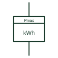

# Energy meter with maximum-demand indicator

Energy meter that also records the highest average power over a fixed demand interval for demand charging.

[Canonical reference](https://eloragrid.ai/symbols/maximum-demand-energy-meter) · [Structured record](../entries/maximum-demand-energy-meter.json) · [All references](README.md)

Updated: 2026-10-28. Drawing use: SLD, Schematic. Reference families: IEC, Manufacturer.

## What it represents

This meter totalises energy and also keeps the maximum average power reached in any demand interval, such as 15 or 30 minutes. Large supplies are often billed partly on that maximum demand, so the meter form appears on the supply single-line diagram with the demand interval stated nearby.
The demand register is reset periodically, usually at the end of a billing period. The symbol does not show the interval, whether it uses fixed blocks or a sliding window, or how reset is performed, and those settings change the recorded value.

## How to read it

- Find the demand interval and window type.
- Check how and when the demand register is reset.

## Drawing checklist

- State demand interval
- Show reset arrangement
- Reference tariff requirement

## Important distinction

A maximum-demand meter records peak averaged power plus energy; a maximum-demand indicator shows only the peak value.

## Facts

- Registers: Energy plus maximum averaged demand
- Key setting: Demand interval
- Preview: Independent educational concept; consult the applicable standard and project legend for the exact graphic

## Public references

- [Power and energy measurement quantities](https://www.se.com/ph/en/faqs/FA343278/) — Schneider Electric. Public explanation of energy and power measurement quantities used by meters.
- [PowerLogic ION9000 user manual](https://www.se.com/us/en/download/document/26719674/) — Schneider Electric. Public meter manual describing measurement, logging and recording features of a revenue and power-quality meter.

## Related references

- [Maximum-demand indicator](maximum-demand-indicator.md)
- [Active-energy meter](active-energy-meter.md)
- [Multi-rate energy meter](multi-rate-energy-meter.md)

Original educational concept geometry, CC BY 4.0. Unitless; not a certified standards glyph or manufacturer footprint.

Elora-authored explanations are CC BY 4.0. Linked standards and manufacturer material retain their own rights. Confirm project requirements using primary sources.
