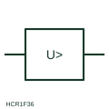

# Maximum-voltage measuring relay

Measuring relay that operates when the monitored voltage rises above its set level.

[Canonical reference](https://eloragrid.ai/symbols/maximum-voltage-relay) · [Structured record](../entries/maximum-voltage-relay.json) · [All references](README.md)

Updated: 2026-10-28. Drawing use: Schematic, SLD. Reference families: IEC, Manufacturer.

## What it represents

The maximum-voltage relay form operates when voltage exceeds its setting. Typical uses include generator overvoltage after load rejection, capacitor bank protection and inverter connection points, where sustained high voltage can stress insulation or breach grid connection limits.
The box shows a greater-than voltage threshold but not whether the element uses phase-to-phase or phase-to-neutral quantities, the reset ratio or the time delay. Grid-connection settings are usually specified as several stages with different delays, which this single symbol does not reveal.

## How to read it

- Identify the voltage connection used by the element.
- Check for multiple stages in the settings record.

## Drawing checklist

- State threshold and delay
- Show VT connection
- Reference stage settings

## Important distinction

A maximum-voltage relay responds to high voltage magnitude; a residual voltage relay responds to neutral displacement.

## Facts

- Measured quantity: Voltage above a set level
- Publisher reference token: HCR1F36 (Autodesk identifier; not an IEC database ID)
- Preview: Independent educational concept; consult the publisher and applicable standard for the exact graphic

## Public references

- [AutoCAD Electrical: Voltage monitoring relays](https://help.autodesk.com/cloudhelp/2021/ENU/AutoCAD-Electrical/files/GUID-5296749E-9336-4B07-9956-160963D6C848.htm) — Autodesk. Public AutoCAD Electrical relay listing that names the Maximum Voltage Protection block; the illustration is independently drawn.
- [IEC graphical symbols for diagrams](https://tc3.iec.ch/tc-activity/graphical-symbols-for-diagrams/) — IEC. IEC context for graphical symbols used in diagrams; no IEC graphic is reproduced.

## Related references

- [Minimum-voltage measuring relay](minimum-voltage-relay.md)
- [Overvoltage](59-overvoltage.md)
- [Voltage transformer](voltage-transformer.md)

Original educational concept geometry, CC BY 4.0. Unitless; not a certified standards glyph or manufacturer footprint.

Elora-authored explanations are CC BY 4.0. Linked standards and manufacturer material retain their own rights. Confirm project requirements using primary sources.
