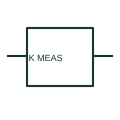

# Measuring relay

A measuring relay responds to a measured electrical quantity and issues an output according to its configuration.

[Canonical reference](https://eloragrid.ai/symbols/measuring-relay) · [Structured record](../entries/measuring-relay.json) · [All references](README.md)

Updated: 2026-10-27. Drawing use: Schematic. Reference families: IEC, Manufacturer.

## What it represents

A measuring relay responds to a measured electrical quantity and issues an output according to its configuration. Measurement inputs, auxiliary supply and output contacts may be separate terminal groups.

## How to read it

- Identify the measured quantity before tracing the output contact logic.
- The preview is an original explanation of this function. Match the actual drawing convention to its legend and the selected equipment documentation.

## Drawing checklist

- Label measured input
- State auxiliary supply
- Reference threshold or setting record

## Important distinction

A measuring relay is not simply a coil powered by the same quantity it measures.

## Facts

- Drawing role: Relay operation
- Representation scope: Functional concept; not an official standard graphic or a product footprint
- Public vendor block reference: HCR1MSR, VCR1MSR (Autodesk identifiers; not IEC symbol numbers)
- Identifier status: The short label is a functional lookup label, not an assigned IEC or IEEE symbol number. Any separately listed Autodesk code is a verified vendor block name.

## Public references

- [Relays and contacts: public symbol reference](https://help.autodesk.com/cloudhelp/2021/ENU/AutoCAD-Electrical/files/GUID-011C62B8-9EC8-485C-B47D-B22A3F7B7574.htm) — Autodesk. Public documentation of this equipment function or named vendor variant; the illustration is independently authored and is not the source graphic.

## Related references

- [Relay coil](relay-coil.md)
- [Normally open contact](normally-open-contact.md)

Original educational concept geometry, CC BY 4.0. Unitless; not a certified standards glyph or manufacturer footprint.

Elora-authored explanations are CC BY 4.0. Linked standards and manufacturer material retain their own rights. Confirm project requirements using primary sources.
