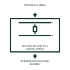

# Microgrid alternate-PCC topology selector

Identifies which documented utility connection path currently defines the microgrid boundary.

[Canonical reference](https://eloragrid.ai/symbols/microgrid-alternate-pcc-topology-selector) · [Structured record](../entries/microgrid-alternate-pcc-topology-selector.json) · [All references](README.md)

Updated: 2026-11-03. Drawing use: Schematic. Reference families: Manufacturer.

Representation: functional-block; installation focus: microgrids.
PCC device states
Selected interconnection boundary

## What it represents

Identifies which documented utility connection path currently defines the microgrid boundary. Microgrid topology control tracks which sources and load sections are electrically connected. The same physical installation can form several islands, so source roles, measurement boundaries and earthing interfaces must follow the established configuration.
In a microgrid with sectionalized buses, the controller can associate each connected source and load group with its current island. A mode-dependent neutral or protection interface needs its own independently validated design. For this reference, the drawing identifies “PCC device states” at the input and “Selected interconnection boundary” at the output. Multiple closed PCCs can change the network relationship.
Keep measured switch positions, logical island assignment and any earthing command separate. A conceptual topology block cannot establish a safe neutral-switching arrangement or prove that a circuit is de-energized. The functional block is an independent explanation of this named application. Equipment-specific ratings, terminal connections and operating conditions must be established in the project documentation.

## How to read it

- Start at the named input: PCC device states. Identify its source device or document and the state represented on the drawing.
- Follow the named output: Selected interconnection boundary. Cross-reference its destination and separate the command from confirmation that the equipment responded.
- Multiple closed PCCs can change the network relationship.
- Keep measured switch positions, logical island assignment and any earthing command separate. A conceptual topology block cannot establish a safe neutral-switching arrangement or prove that a circuit is de-energized.

## Drawing checklist

- Label the source and connection reference for pcc device states.
- Identify the destination and defined state of selected interconnection boundary.
- Record the equipment or control-document revision supporting this functional block.
- Check this application limit in the project design: Multiple closed PCCs can change the network relationship.

## Important distinction

Multiple closed PCCs can change the network relationship. This reference describes the named application; it does not establish a new IEC graphical symbol, an ANSI device-function number or an exact manufacturer connection diagram.

## Facts

- Representation: Functional block
- Installation focus: Microgrids
- Input / boundary: PCC device states
- Output / connection: Selected interconnection boundary
- Lookup label: MATS is a library lookup label, not a standard device designation.

## Public references

- [Microgrid operating modes and transitions management](https://productinfo.se.com/emol_functional_specifications/doca0371_emol_functionalspecifications/EN/DOCA0371_EMOL_Functional_Specifications_DD00894746.xml/%24/EMOL_OperatingModesandTransitionsManagement_DD00895904) — Schneider Electric. Public technical context for microgrid topology and earthing coordination. Grid-connected and island modes, transitions, topology and authority. The application text and educational graphic are independently authored; the publisher does not certify this representation.

## Related references

- [Microgrid interconnection switch](microgrid-interconnection-switch.md)
- [Neutral earthing resistor](neutral-earthing-resistor.md)
- [Microgrid tie-breaker island-merge request](microgrid-tie-breaker-island-merge-request.md)

Original educational concept geometry, CC BY 4.0. Unitless; not a certified standards glyph or manufacturer footprint.

Elora-authored explanations are CC BY 4.0. Linked standards and manufacturer material retain their own rights. Confirm project requirements using primary sources.
