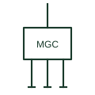

# Microgrid controller

The supervisory controller that dispatches sources, storage and loads and manages islanding and reconnection of a microgrid.

[Canonical reference](https://eloragrid.ai/symbols/microgrid-controller) · [Structured record](../entries/microgrid-controller.json) · [All references](README.md)

Updated: 2026-10-28. Drawing use: SLD, Schematic. Reference families: IEC, IEEE / ANSI.

## What it represents

A microgrid controller coordinates the sources, storage and controllable loads within a microgrid. It sets operating points for inverters and gensets, maintains spinning reserve, sheds and restores load, and manages transitions between grid-connected and islanded operation, including black start and resynchronisation.
On single-line diagrams it is shown as a control block, often at the side of the drawing, with dashed communication lines to each controlled breaker, inverter, genset controller and meter. Architecture drawings show it in more detail, including the communication protocols and the hierarchy of controllers below it.
The block does not reveal how fast the controller acts or which functions run locally in device controllers instead. Protection must never rely on the supervisory controller alone, so check that each device has its own protection independent of the communication link.

## How to read it

- Dashed lines from the block are signal or communication links, not power paths.
- Identify which functions remain local if communication fails.

## Drawing checklist

- List controlled devices and signals.
- Show communication links and protocols.
- Reference operating modes and fallback behaviour.

## Important distinction

A microgrid controller supervises the whole system; a genset or inverter controller controls one device.

## Facts

- Role: Supervisory dispatch and transitions
- Links: Communication to device controllers
- Preview: Independent educational illustration; not a product outline

## Public references

- [Reliable hybrid power and microgrid solutions](https://www.deif.com/applications/power-generation/reliable-hybrid-power-and-microgrid-solutions/) — DEIF. Public hybrid and microgrid control solution context.
- [Cerbo GX official product and documents](https://www.victronenergy.com/communication-centres/cerbo-gx) — Victron Energy. Public system monitoring and control centre documentation.

## Related references

- [Genset controller](genset-controller.md)
- [Microgrid interconnection switch](microgrid-interconnection-switch.md)
- [Power plant controller](power-plant-controller.md)
- [Energy-management controller](ga-energy-management-controller.md)

Original educational concept geometry, CC BY 4.0. Unitless; not a certified standards glyph or manufacturer footprint.

Elora-authored explanations are CC BY 4.0. Linked standards and manufacturer material retain their own rights. Confirm project requirements using primary sources.
