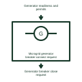

# Microgrid generator breaker-connect request

Requests the assigned generator connection after the selected readiness and synchronising conditions.

[Canonical reference](https://eloragrid.ai/symbols/microgrid-generator-breaker-connect-request) · [Structured record](../entries/microgrid-generator-breaker-connect-request.json) · [All references](README.md)

Updated: 2026-11-03. Drawing use: Schematic. Reference families: Manufacturer.

Representation: functional-block; installation focus: microgrids.
Generator readiness and permits
Generator breaker close request

## What it represents

Requests the assigned generator connection after the selected readiness and synchronising conditions. Generating-set coordination decides which available machines should operate and how their power contribution is shared. Engine starting, breaker connection, load acceptance and stopping are separate stages with their own feedback.
In a microgrid power station, the controller can request an additional generator when available reserve falls and later unload a selected machine before its documented stop sequence. For this reference, the drawing identifies “Generator readiness and permits” at the input and “Generator breaker close request” at the output. The final breaker circuit retains its own interlocks.
Preserve the engine and generator electrical boundaries, command authority and source readiness. Starting duty, minimum loading, synchronising, fuel systems and cooling behavior require the selected generator documentation. The functional block is an independent explanation of this named application. Equipment-specific ratings, terminal connections and operating conditions must be established in the project documentation.

## How to read it

- Start at the named input: Generator readiness and permits. Identify its source device or document and the state represented on the drawing.
- Follow the named output: Generator breaker close request. Cross-reference its destination and separate the command from confirmation that the equipment responded.
- The final breaker circuit retains its own interlocks.
- Preserve the engine and generator electrical boundaries, command authority and source readiness. Starting duty, minimum loading, synchronising, fuel systems and cooling behavior require the selected generator documentation.

## Drawing checklist

- Label the source and connection reference for generator readiness and permits.
- Identify the destination and defined state of generator breaker close request.
- Record the equipment or control-document revision supporting this functional block.
- Check this application limit in the project design: The final breaker circuit retains its own interlocks.

## Important distinction

The final breaker circuit retains its own interlocks. This reference describes the named application; it does not establish a new IEC graphical symbol, an ANSI device-function number or an exact manufacturer connection diagram.

## Facts

- Representation: Functional block
- Installation focus: Microgrids
- Input / boundary: Generator readiness and permits
- Output / connection: Generator breaker close request
- Lookup label: MGBR is a library lookup label, not a standard device designation.

## Public references

- [AGC power management options G4, G5 and G8](https://www.deif.com/media/5a4bx0xv/agc-3-option-g4-g5-and-g8-power-management-4189340696-uk.pdf) — DEIF. Public technical context for microgrid generating-set coordination. Generator start/stop, load sharing, reserve and power management. The application text and educational graphic are independently authored; the publisher does not certify this representation.

## Related references

- [Genset controller](genset-controller.md)
- [Diesel generator set](diesel-generator-set.md)
- [Microgrid generator active-load sharing](microgrid-generator-active-load-sharing.md)

Original educational concept geometry, CC BY 4.0. Unitless; not a certified standards glyph or manufacturer footprint.

Elora-authored explanations are CC BY 4.0. Linked standards and manufacturer material retain their own rights. Confirm project requirements using primary sources.
