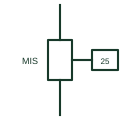

# Microgrid interconnection switch

The switching device that separates a microgrid from the utility for islanding and reconnects it after synchronising.

[Canonical reference](https://eloragrid.ai/symbols/microgrid-interconnection-switch) · [Structured record](../entries/microgrid-interconnection-switch.json) · [All references](README.md)

Updated: 2026-10-28. Drawing use: SLD. Reference families: IEC, IEEE / ANSI.

## What it represents

The microgrid interconnection switch is the breaker or switch at the boundary with the utility that opens to island the microgrid and closes to reconnect it. Its control is tied to interface protection, which detects loss of mains, and to the microgrid controller, which manages planned islanding and resynchronisation.
Single-line diagrams show a circuit breaker at the point of common coupling with protection functions listed beside it, commonly under and over voltage, under and over frequency, rate of change of frequency, directional power and synchronism check. A label such as MIS or island breaker identifies its role.
The breaker itself is an ordinary device; its function comes from the protection and control logic. The symbol does not show whether reconnection is automatic, how long it waits or whether a seamless transition is possible.

## How to read it

- Read the protection functions listed beside the breaker.
- Synchronism check must supervise closing.

## Drawing checklist

- State interface protection functions and settings source.
- Show synchronism check and controller link.
- Reference islanding and reconnection logic.

## Important distinction

The interconnection switch defines the island boundary; a generator breaker connects only one source.

## Facts

- Device: Circuit breaker or switch
- Key protection: Voltage, frequency, ROCOF, reverse power
- Closing supervision: Synchronism check
- Preview: Independent educational illustration; consult the applicable standard and project legend for the exact graphic

## Public references

- [Reliable hybrid power and microgrid solutions](https://www.deif.com/applications/power-generation/reliable-hybrid-power-and-microgrid-solutions/) — DEIF. Public microgrid control context with mains interaction.
- [Public reference table of ANSI device-function numbers](https://www.se.com/es/es/faqs/FA34639/) — Schneider Electric. Public device-function number table for interface protection functions.

## Related references

- [Point of common coupling](point-of-common-coupling.md)
- [Microgrid controller](microgrid-controller.md)
- [Synchronism check](25-synchronism-check.md)
- [Rate-of-change-of-frequency protection](81r-rate-of-change-of-frequency-protection.md)

Original educational concept geometry, CC BY 4.0. Unitless; not a certified standards glyph or manufacturer footprint.

Elora-authored explanations are CC BY 4.0. Linked standards and manufacturer material retain their own rights. Confirm project requirements using primary sources.
