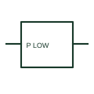

# Minimum active-power relay

A minimum active-power relay operates according to a configured low active-power condition.

[Canonical reference](https://eloragrid.ai/symbols/minimum-active-power-relay) · [Structured record](../entries/minimum-active-power-relay.json) · [All references](README.md)

Updated: 2026-10-27. Drawing use: SLD, Schematic. Reference families: Manufacturer.

## What it represents

A minimum active-power relay operates according to a configured low active-power condition. The measurement direction and enable logic determine what low power means in the control sequence.

## How to read it

- Identify the directional convention before evaluating the threshold.
- The preview is an original explanation of this function. Match the actual drawing convention to its legend and the selected equipment documentation.

## Drawing checklist

- Show voltage/current inputs
- State power direction
- Reference threshold and enabling logic

## Important distinction

Minimum active power and reverse power are different operating criteria.

## Facts

- Drawing role: Monitoring element
- Representation scope: Functional concept; not an official standard graphic or a product footprint
- Public vendor block reference: HCR1F43, VCR1F43 (Autodesk identifiers; not IEC symbol numbers)
- Identifier status: The short label is a functional lookup label, not an assigned IEC or IEEE symbol number. Any separately listed Autodesk code is a verified vendor block name.

## Public references

- [AutoCAD Electrical: Miscellaneous monitoring relays](https://help.autodesk.com/cloudhelp/2021/ENU/AutoCAD-Electrical/files/GUID-31F4CF79-F8E0-4E5A-8C51-4D71640ACDB8.htm) — Autodesk. Public documentation of this equipment function or named vendor variant; the illustration is independently authored and is not the source graphic.

## Related references

- [Current transformer](current-transformer.md)
- [Relay coil](relay-coil.md)

Original educational concept geometry, CC BY 4.0. Unitless; not a certified standards glyph or manufacturer footprint.

Elora-authored explanations are CC BY 4.0. Linked standards and manufacturer material retain their own rights. Confirm project requirements using primary sources.
