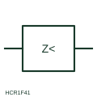

# Minimum-impedance measuring relay

Measuring relay that compares voltage with current and operates when the apparent impedance falls below a set value.

[Canonical reference](https://eloragrid.ai/symbols/minimum-impedance-relay) · [Structured record](../entries/minimum-impedance-relay.json) · [All references](README.md)

Updated: 2026-10-28. Drawing use: Schematic, SLD. Reference families: IEC, Manufacturer.

## What it represents

A minimum-impedance relay divides measured voltage by measured current and operates when the result falls below its setting, indicating a fault close enough to fall inside its reach. It is used as generator and transformer backup protection and is the basic idea behind distance protection.
The relay needs both CT and VT inputs, so the symbol should always be read with both connections. It does not show the characteristic shape on the impedance plane, any directional element, or the loss-of-voltage blocking needed to avoid operation when the VT supply fails.

## How to read it

- Confirm both voltage and current inputs are shown.
- Check for VT fuse-failure blocking.

## Drawing checklist

- Show CT and VT inputs
- State reach and delay
- Reference blocking logic

## Important distinction

A minimum-impedance relay uses voltage and current together; an overcurrent relay uses current alone.

## Facts

- Measured quantity: Apparent impedance from voltage and current
- Publisher reference token: HCR1F41 (Autodesk identifier; not an IEC database ID)
- Preview: Independent educational concept; consult the publisher and applicable standard for the exact graphic

## Public references

- [AutoCAD Electrical: Miscellaneous monitoring relays](https://help.autodesk.com/cloudhelp/2021/ENU/AutoCAD-Electrical/files/GUID-31F4CF79-F8E0-4E5A-8C51-4D71640ACDB8.htm) — Autodesk. Public AutoCAD Electrical relay listing that names the Minimum Impedance Relay block; the illustration is independently drawn.
- [IEC graphical symbols for diagrams](https://tc3.iec.ch/tc-activity/graphical-symbols-for-diagrams/) — IEC. IEC context for graphical symbols used in diagrams; no IEC graphic is reproduced.

## Related references

- [Distance protection](21-distance-protection.md)
- [Voltage transformer](voltage-transformer.md)
- [Current transformer](current-transformer.md)

Original educational concept geometry, CC BY 4.0. Unitless; not a certified standards glyph or manufacturer footprint.

Elora-authored explanations are CC BY 4.0. Linked standards and manufacturer material retain their own rights. Confirm project requirements using primary sources.
