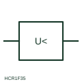

# Minimum-voltage measuring relay

Measuring relay that operates when voltage falls below a set level while some voltage is still present.

[Canonical reference](https://eloragrid.ai/symbols/minimum-voltage-relay) · [Structured record](../entries/minimum-voltage-relay.json) · [All references](README.md)

Updated: 2026-10-28. Drawing use: Schematic, SLD. Reference families: IEC, Manufacturer.

## What it represents

The minimum-voltage relay form operates when the measured voltage falls below its setting. It is used for motor undervoltage tripping, load shedding and transfer schemes, where a sustained voltage dip indicates a supply problem rather than a momentary disturbance.
The symbol shows the voltage quantity and the less-than threshold but not the time delay, which phases are monitored or whether operation is blocked on VT fuse failure. Without a blocking input a blown VT fuse can cause an unwanted trip, so the supervision arrangement should be cross-referenced.

## How to read it

- Check which phase voltages are monitored.
- Look for VT supervision or fuse-failure blocking.

## Drawing checklist

- State threshold and delay
- Show VT source
- Reference blocking input

## Important distinction

A minimum-voltage relay responds to a reduced voltage; a loss-of-voltage relay responds to absence of voltage.

## Facts

- Measured quantity: Voltage below a set level
- Publisher reference token: HCR1F35 (Autodesk identifier; not an IEC database ID)
- Preview: Independent educational concept; consult the publisher and applicable standard for the exact graphic

## Public references

- [AutoCAD Electrical: Voltage monitoring relays](https://help.autodesk.com/cloudhelp/2021/ENU/AutoCAD-Electrical/files/GUID-5296749E-9336-4B07-9956-160963D6C848.htm) — Autodesk. Public AutoCAD Electrical relay listing that names the Minimum Voltage Protection block; the illustration is independently drawn.
- [IEC graphical symbols for diagrams](https://tc3.iec.ch/tc-activity/graphical-symbols-for-diagrams/) — IEC. IEC context for graphical symbols used in diagrams; no IEC graphic is reproduced.

## Related references

- [Loss-of-voltage monitoring relay](loss-of-voltage-monitoring-relay.md)
- [Undervoltage](27-undervoltage.md)
- [Voltage transformer](voltage-transformer.md)

Original educational concept geometry, CC BY 4.0. Unitless; not a certified standards glyph or manufacturer footprint.

Elora-authored explanations are CC BY 4.0. Linked standards and manufacturer material retain their own rights. Confirm project requirements using primary sources.
