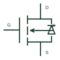

# MOSFET body diode

The intrinsic diode associated with a MOSFET's semiconductor structure, often shown within the device reference.

[Canonical reference](https://eloragrid.ai/symbols/mosfet-body-diode) · [Structured record](../entries/mosfet-body-diode.json) · [All references](README.md)

Updated: 2026-10-27. Drawing use: Schematic. Reference families: Manufacturer.

## What it represents

The intrinsic diode associated with a MOSFET's semiconductor structure, often shown within the device reference.
On a schematic, identify the MOSFET type and diode direction relative to drain/source and trace the commutation or reverse-current route. Keep the component tag and signal/reference names consistent across the control drawing, terminal schedule and device documentation.
The body diode is internal to the MOSFET; its presence does not establish that an external freewheeling diode is unnecessary.
Terminal letters describe electrical roles, not package pin numbers. Check the selected public datasheet for the actual pin assignment, polarity and any internally connected terminals before completing the drawing.

## How to read it

- Identify the MOSFET type and diode direction relative to drain/source.
- Trace the commutation or reverse-current route.

## Drawing checklist

- Label the MOSFET type and diode direction relative to drain/source.
- Cross-reference the commutation or reverse-current route.
- Add the selected device or circuit documentation revision, power/reference connections and project signal convention.

## Important distinction

The body diode is internal to the MOSFET; its presence does not establish that an external freewheeling diode is unnecessary.

## Facts

- Common schematic mnemonic: BODY-D — descriptive only; project/device documentation defines reference designations.
- Terminal / interface focus: The MOSFET type and diode direction relative to drain/source
- Artwork scope: Original educational component glyph; not a certified standard graphic or package pinout.

## Public references

- [MOSFET families and application documentation](https://www.nexperia.com/products/mosfets) — Nexperia. Public primary manufacturer documentation establishes the component function or circuit/topology relationship. Preview geometry and drafting explanations are independently authored.

## Related references

- [N-channel enhancement MOSFET](n-channel-enhancement-mosfet.md)
- [Diode](diode.md)

Original educational concept geometry, CC BY 4.0. Unitless; not a certified standards glyph or manufacturer footprint.

Elora-authored explanations are CC BY 4.0. Linked standards and manufacturer material retain their own rights. Confirm project requirements using primary sources.
