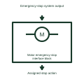

# Motor emergency-stop interface block

Shows how the documented emergency-stop function interfaces with the motor feeder.

[Canonical reference](https://eloragrid.ai/symbols/motor-emergency-stop-interface-block) · [Structured record](../entries/motor-emergency-stop-interface-block.json) · [All references](README.md)

Updated: 2026-11-03. Drawing use: Schematic. Reference families: Manufacturer.

Representation: functional-block; installation focus: switchgear.
Emergency-stop system output
Assigned stop action

## What it represents

Shows how the documented emergency-stop function interfaces with the motor feeder. A motor feeder combines switching, motor protection and an operating command. Starting permission, running feedback and protection trip are different signals even where one relay or controller processes all of them.
In a switchroom motor-control panel, a ventilation motor can receive an automatic start request while a local selector and the motor protection determine whether the feeder is available. For this reference, the drawing identifies “Emergency-stop system output” at the input and “Assigned stop action” at the output. The block does not define safety-system performance.
Link the motor tag to its contactor, protective device and process permissives. The control diagram must identify stop priority, feedback and restart philosophy without supplying unverified settings. The functional block is an independent explanation of this named application. Equipment-specific ratings, terminal connections and operating conditions must be established in the project documentation.

## How to read it

- Start at the named input: Emergency-stop system output. Identify its source device or document and the state represented on the drawing.
- Follow the named output: Assigned stop action. Cross-reference its destination and separate the command from confirmation that the equipment responded.
- The block does not define safety-system performance.
- Link the motor tag to its contactor, protective device and process permissives. The control diagram must identify stop priority, feedback and restart philosophy without supplying unverified settings.

## Drawing checklist

- Label the source and connection reference for emergency-stop system output.
- Identify the destination and defined state of assigned stop action.
- Record the equipment or control-document revision supporting this functional block.
- Check this application limit in the project design: The block does not define safety-system performance.

## Important distinction

The block does not define safety-system performance. This reference describes the named application; it does not establish a new IEC graphical symbol, an ANSI device-function number or an exact manufacturer connection diagram.

## Facts

- Representation: Functional block
- Installation focus: Switchgear
- Input / boundary: Emergency-stop system output
- Output / connection: Assigned stop action
- Lookup label: MEIB is a library lookup label, not a standard device designation.

## Public references

- [SEL-710 motor protection and control](https://selinc.com/products/710/) — SEL. Public technical context for motor-feeder control interfaces. Motor feeder thermal, starting and control functions. The application text and educational graphic are independently authored; the publisher does not certify this representation.

## Related references

- [Contactor](contactor.md)
- [Motor overload trip NC contact](motor-overload-trip-nc-contact.md)
- [Motor protection reset permissive](motor-protection-reset-permissive.md)

Original educational concept geometry, CC BY 4.0. Unitless; not a certified standards glyph or manufacturer footprint.

Elora-authored explanations are CC BY 4.0. Linked standards and manufacturer material retain their own rights. Confirm project requirements using primary sources.
