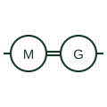

# Motor-generator set

A motor mechanically coupled to a generator, used to isolate, change frequency or convert between AC and DC.

[Canonical reference](https://eloragrid.ai/symbols/motor-generator-set) · [Structured record](../entries/motor-generator-set.json) · [All references](README.md)

Updated: 2026-10-28. Drawing use: SLD, Schematic. Reference families: IEC, IEEE / ANSI.

## What it represents

A motor-generator set is an electric motor driving a generator on a common shaft. It provides complete electrical isolation, conversion of frequency or voltage, or AC to DC conversion, and its rotating mass rides through short disturbances. Some sets add a flywheel or an engine on the same shaft for backup.
Drawings show two machine circles, one marked M and one marked G, joined by a mechanical coupling line. The motor input and generator output are on separate circuits, each with its own protection and earthing.
Efficiency is lower than a static converter and the rotating machines need maintenance, so motor-generator sets are now mainly found in legacy, test or special-purpose installations. The symbol does not show speed, coupling arrangement or ride-through time.

## How to read it

- The coupling line shows a mechanical link, not an electrical one.
- Earthing of the generator output is independent of the motor supply.

## Drawing checklist

- State motor and generator ratings.
- Show output earthing and protection.
- Reference flywheel or engine if fitted.

## Important distinction

A motor-generator set converts through rotating machines; a static frequency converter uses power electronics.

## Facts

- Machines: Motor and generator on one shaft
- Isolation: Complete electrical separation
- Ride-through: From rotating inertia
- Preview: Independent educational illustration; consult the applicable standard and project legend for the exact graphic

## Public references

- [IEEE/ANSI 315-1975: graphic symbols for electrical and electronics diagrams](https://standards.ieee.org/ieee/315/515/) — IEEE Standards Association. Graphic-symbol standards context for rotating machines.
- [Generator symbol variants](https://help.autodesk.com/cloudhelp/2021/ENU/AutoCAD-Electrical/files/GUID-09BE3BB5-9118-4302-8061-3888692E538F.htm) — Autodesk. Public generator symbol family context.

## Related references

- [Static frequency converter](static-frequency-converter.md)
- [Auxiliary motor or motor-generator](88-auxiliary-motor-or-motor-generator.md)
- [Rotary UPS](rotary-ups.md)
- [Generator](generator.md)

Original educational concept geometry, CC BY 4.0. Unitless; not a certified standards glyph or manufacturer footprint.

Elora-authored explanations are CC BY 4.0. Linked standards and manufacturer material retain their own rights. Confirm project requirements using primary sources.
