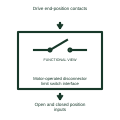

# Motor-operated disconnector limit switch interface

Carries the selected mechanism's end-position contacts into the yard control circuit.

[Canonical reference](https://eloragrid.ai/symbols/motor-operated-disconnector-limit-switch-interface) · [Structured record](../entries/motor-operated-disconnector-limit-switch-interface.json) · [All references](README.md)

Updated: 2026-11-03. Drawing use: Schematic. Reference families: Manufacturer.

Representation: functional-block; installation focus: switchyards.
Drive end-position contacts
Open and closed position inputs

## What it represents

Carries the selected mechanism's end-position contacts into the yard control circuit. Disconnector and earthing references identify different mechanical constructions and connection duties within a yard. The primary diagram shows which conductors are joined or earthed; the equipment drawing explains how its contacts and supports move.
In a switchyard bay, a bus selector can use a different physical construction from a line disconnector. Each device still needs an identified operating mechanism, position indication and interlocking interface. For this reference, the drawing identifies “Drive end-position contacts” at the input and “Open and closed position inputs” at the output. Motor-stop limits and indication contacts may differ.
The construction name does not establish load-breaking capability, short-circuit making duty or operating permission. Verify these properties in the selected equipment data and the station interlocking scheme. The functional block is an independent explanation of this named application. Equipment-specific ratings, terminal connections and operating conditions must be established in the project documentation.

## How to read it

- Start at the named input: Drive end-position contacts. Identify its source device or document and the state represented on the drawing.
- Follow the named output: Open and closed position inputs. Cross-reference its destination and separate the command from confirmation that the equipment responded.
- Motor-stop limits and indication contacts may differ.
- The construction name does not establish load-breaking capability, short-circuit making duty or operating permission. Verify these properties in the selected equipment data and the station interlocking scheme.

## Drawing checklist

- Label the source and connection reference for drive end-position contacts.
- Identify the destination and defined state of open and closed position inputs.
- Record the equipment or control-document revision supporting this functional block.
- Check this application limit in the project design: Motor-stop limits and indication contacts may differ.

## Important distinction

Motor-stop limits and indication contacts may differ. This reference describes the named application; it does not establish a new IEC graphical symbol, an ANSI device-function number or an exact manufacturer connection diagram.

## Facts

- Representation: Functional block
- Installation focus: Switchyards
- Input / boundary: Drive end-position contacts
- Output / connection: Open and closed position inputs
- Lookup label: MDLSI is a library lookup label, not a standard device designation.

## Public references

- [Disconnectors and earthing switches](https://www.siemens-energy.com/global/en/home/products-services/product-offerings/disconnectors-earthing-switches.html) — Siemens Energy. Public technical context for disconnector and earthing applications. Disconnector construction, earthing switches and operating mechanisms. The application text and educational graphic are independently authored; the publisher does not certify this representation.

## Related references

- [Disconnector](disconnector.md)
- [Earthing switch](earthing-switch.md)
- [Disconnector operating-torque alarm interface](disconnector-operating-torque-alarm-interface.md)

Original educational concept geometry, CC BY 4.0. Unitless; not a certified standards glyph or manufacturer footprint.

Elora-authored explanations are CC BY 4.0. Linked standards and manufacturer material retain their own rights. Confirm project requirements using primary sources.
