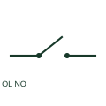

# Motor overload alarm NO contact

An overload alarm NO contact closes on the documented overload relay operation.

[Canonical reference](https://eloragrid.ai/symbols/motor-overload-alarm-no-contact) · [Structured record](../entries/motor-overload-alarm-no-contact.json) · [All references](README.md)

Updated: 2026-10-27. Drawing use: Schematic. Reference families: IEC, Manufacturer.

## What it represents

An overload alarm NO contact closes on the documented overload relay operation. The schematic identifies the alarm or feedback path independently of the motor-stopping contact.

## How to read it

- Verify the contact behaviour after reset and after loss of auxiliary supply.
- The preview is an original explanation of this function. Match the actual drawing convention to its legend and the selected equipment documentation.

## Drawing checklist

- Link overload device
- Identify alarm destination
- Reference contact terminal pair

## Important distinction

A trip alarm contact is different from a contactor position indication contact.

## Facts

- Drawing role: Contact state
- Representation scope: Functional concept; not an official standard graphic or a product footprint
- Public vendor block reference: HOL21, VOL21 (Autodesk identifiers; not IEC symbol numbers)
- Identifier status: The short label is a functional lookup label, not an assigned IEC or IEEE symbol number. Any separately listed Autodesk code is a verified vendor block name.

## Public references

- [AutoCAD Electrical: Motor control and overloads](https://help.autodesk.com/cloudhelp/2021/ENU/AutoCAD-Electrical/files/GUID-D74101D4-8702-418C-B349-B15EEAEFAA20.htm) — Autodesk. Public documentation of this equipment function or named vendor variant; the illustration is independently authored and is not the source graphic.

## Related references

- [Normally open contact](normally-open-contact.md)
- [Normally closed contact](normally-closed-contact.md)

Original educational concept geometry, CC BY 4.0. Unitless; not a certified standards glyph or manufacturer footprint.

Elora-authored explanations are CC BY 4.0. Linked standards and manufacturer material retain their own rights. Confirm project requirements using primary sources.
