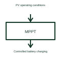

# MPPT solar charge controller

An MPPT charge controller adjusts a solar operating point while controlling its charging output.

[Canonical reference](https://eloragrid.ai/symbols/mppt-charge-controller) · [Structured record](../entries/mppt-charge-controller.json) · [All references](README.md)

Updated: 2026-10-27. Drawing use: Schematic. Reference families: Manufacturer.

## What it represents

An MPPT charge controller adjusts a solar operating point while controlling its charging output.
The controller can seek a useful power operating point as sunlight and other conditions change.
Show the solar-side input and battery-side charging output separately. MPPT searches for a useful solar operating point, while charging control follows the selected battery requirements. A drawing should identify both jobs instead of suggesting that tracking maximum solar power alone establishes a suitable charging process. This is original functional artwork, not a certified standard graphic or device pinout.

## How to read it

- Identify the PV input and battery output arrangements.
- Reference the supported battery charging requirements.
- Show enable, measurement and status interfaces where used.
- Maximum power point tracking and battery charging control are related but different jobs.

## Drawing checklist

- Identify the PV input and battery output arrangements.
- Reference the supported battery charging requirements.
- Show enable, measurement and status interfaces where used.

## Important distinction

Maximum power point tracking and battery charging control are related but different jobs.

## Facts

- Representation type: Original functional block; not a certified IEC or IEEE graphic
- Concept input: PV operating conditions
- Concept output: Controlled battery charging

## Public references

- [Solar charge controller architecture](https://www.ti.com/solution/solar-charge-controller) — Texas Instruments. Solar charge controller architecture: public technical context for the named function. Product and compliance details remain with the publisher.

## Related references

- [MPPT solar charge controller](ga-mppt-solar-charge-controller.md)
- [Power converter / inverter](power-converter.md)
- [Terminal connection](terminal.md)

Original educational concept geometry, CC BY 4.0. Unitless; not a certified standards glyph or manufacturer footprint.

Elora-authored explanations are CC BY 4.0. Linked standards and manufacturer material retain their own rights. Confirm project requirements using primary sources.
