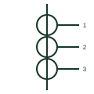

# Multi-core current transformer

CT with several independent magnetic cores on one primary, each with its own secondary for metering or protection.

[Canonical reference](https://eloragrid.ai/symbols/multi-core-current-transformer) · [Structured record](../entries/multi-core-current-transformer.json) · [All references](README.md)

Updated: 2026-10-28. Drawing use: SLD, Schematic. Reference families: IEC, Manufacturer.

## What it represents

A multi-core CT has one primary passing through two or more separate cores, each with its own secondary winding. Typical MV and HV CTs have one metering core and one or more protection cores, so the single-line diagram shows each core as its own ring on the primary with its ratio and class beside it.
Separate cores mean a fault-saturated protection core does not disturb the metering core, and each can have a different accuracy class. The symbol shows how many cores exist but not which relay or meter each feeds, so every core needs its own designation and cross-reference.

## How to read it

- Count the cores and read each ratio and class separately.
- Follow each secondary to its own relay or meter.

## Drawing checklist

- Label each core
- State ratio and class per core
- Cross-reference each secondary circuit

## Important distinction

A multi-core CT has separate magnetic cores; a CT with two secondaries on a common core shares one magnetic circuit.

## Facts

- Construction: Separate cores on one primary
- Typical split: Metering core plus protection cores
- Preview: Independent educational concept; consult the applicable standard and project legend for the exact graphic

## Public references

- [Indoor current and voltage transformers](https://www.abb.com/gb/en/areas/electrification/medium-voltage/grid-components/core-components/indoor-instrument-transformers) — ABB. Public manufacturer overview of indoor current and voltage instrument transformers.
- [Current transformer symbol variants](https://help.autodesk.com/cloudhelp/2021/ENU/AutoCAD-Electrical/files/GUID-40AAEF4A-AC3F-4B3D-90A5-A9E0707C1241.htm) — Autodesk. Public AutoCAD Electrical current transformer family used for context; this variant is independently drawn.

## Related references

- [Current transformer with two secondaries](current-transformer-with-two-secondaries.md)
- [Current transformer](current-transformer.md)
- [Bushing current transformer](bushing-current-transformer.md)

Original educational concept geometry, CC BY 4.0. Unitless; not a certified standards glyph or manufacturer footprint.

Elora-authored explanations are CC BY 4.0. Linked standards and manufacturer material retain their own rights. Confirm project requirements using primary sources.
