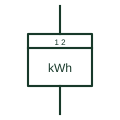

# Multi-rate energy meter

Energy meter that switches between registers by time or tariff signal so energy is billed at different rates.

[Canonical reference](https://eloragrid.ai/symbols/multi-rate-energy-meter) · [Structured record](../entries/multi-rate-energy-meter.json) · [All references](README.md)

Updated: 2026-10-28. Drawing use: SLD, Schematic. Reference families: IEC, Manufacturer.

## What it represents

A multi-rate meter has two or more registers and switches between them according to an internal clock or an external tariff signal. Older installations use a ripple control receiver or time switch to change rate, which is why the schematic may show a control input to the meter.
The symbol marks the multiple registers but not the rate schedule. Tariff periods are set by the supply agreement and meter programming, and the drawing should reference the tariff source rather than assume it from the meter form.

## How to read it

- Look for an external tariff switching input.
- Check that the register count matches the tariff.

## Drawing checklist

- Show tariff switching source
- State number of registers
- Reference meter program

## Important distinction

A multi-rate meter splits energy by time or tariff; a bidirectional meter splits energy by direction.

## Facts

- Registers: Two or more tariff registers
- Switching: Internal clock or external tariff signal
- Preview: Independent educational concept; consult the applicable standard and project legend for the exact graphic

## Public references

- [Power and energy measurement quantities](https://www.se.com/ph/en/faqs/FA343278/) — Schneider Electric. Public explanation of energy and power measurement quantities used by meters.
- [IEC graphical symbols for diagrams](https://tc3.iec.ch/tc-activity/graphical-symbols-for-diagrams/) — IEC. IEC context for graphical symbols used in diagrams; no IEC graphic is reproduced.

## Related references

- [Active-energy meter](active-energy-meter.md)
- [Energy meter with maximum-demand indicator](maximum-demand-energy-meter.md)
- [Clock indication](iec-clock-indication.md)

Original educational concept geometry, CC BY 4.0. Unitless; not a certified standards glyph or manufacturer footprint.

Elora-authored explanations are CC BY 4.0. Linked standards and manufacturer material retain their own rights. Confirm project requirements using primary sources.
