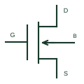

# N-channel depletion MOSFET

An N-channel insulated-gate device that conducts at zero gate-to-source voltage according to its device characteristics.

[Canonical reference](https://eloragrid.ai/symbols/n-channel-depletion-mosfet) · [Structured record](../entries/n-channel-depletion-mosfet.json) · [All references](README.md)

Updated: 2026-10-27. Drawing use: Schematic. Reference families: Manufacturer.

## What it represents

An N-channel insulated-gate device that conducts at zero gate-to-source voltage according to its device characteristics.
On a schematic, identify the gate bias needed to reduce conduction and the source reference and trace the bias, current-limiting or switching circuit. Keep the component tag and signal/reference names consistent across the control drawing, terminal schedule and device documentation.
Depletion-mode conduction at zero gate bias differs from enhancement mode and changes the circuit's default state.
Terminal letters describe electrical roles, not package pin numbers. Check the selected public datasheet for the actual pin assignment, polarity and any internally connected terminals before completing the drawing.

## How to read it

- Identify the gate bias needed to reduce conduction and the source reference.
- Trace the bias, current-limiting or switching circuit.

## Drawing checklist

- Label the gate bias needed to reduce conduction and the source reference.
- Cross-reference the bias, current-limiting or switching circuit.
- Add the selected device or circuit documentation revision, power/reference connections and project signal convention.

## Important distinction

Depletion-mode conduction at zero gate bias differs from enhancement mode and changes the circuit's default state.

## Facts

- Common schematic mnemonic: N-DMOS — descriptive only; project/device documentation defines reference designations.
- Terminal / interface focus: The gate bias needed to reduce conduction and the source reference
- Artwork scope: Original educational component glyph; not a certified standard graphic or package pinout.

## Public references

- [DN2540 depletion-mode MOSFET documentation](https://www.microchip.com/en-us/product/DN2540) — Microchip Technology. Public primary manufacturer documentation establishes the component function or circuit/topology relationship. Preview geometry and drafting explanations are independently authored.

## Related references

- [N-channel enhancement MOSFET](n-channel-enhancement-mosfet.md)
- [Diode](diode.md)

Original educational concept geometry, CC BY 4.0. Unitless; not a certified standards glyph or manufacturer footprint.

Elora-authored explanations are CC BY 4.0. Linked standards and manufacturer material retain their own rights. Confirm project requirements using primary sources.
