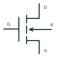

# N-channel enhancement MOSFET

An insulated-gate transistor whose N-channel conduction is enabled by the documented gate-to-source drive.

[Canonical reference](https://eloragrid.ai/symbols/n-channel-enhancement-mosfet) · [Structured record](../entries/n-channel-enhancement-mosfet.json) · [All references](README.md)

Updated: 2026-10-27. Drawing use: Schematic. Reference families: Manufacturer.

## What it represents

An insulated-gate transistor whose N-channel conduction is enabled by the documented gate-to-source drive.
On a schematic, identify gate, drain, source and any exposed bulk or Kelvin-source terminal and trace the switching path, driver return and body-diode orientation. Keep the component tag and signal/reference names consistent across the control drawing, terminal schedule and device documentation.
Enhancement mode differs from depletion mode; a MOSFET gate must not be treated as a bipolar base-current input.
Terminal letters describe electrical roles, not package pin numbers. Check the selected public datasheet for the actual pin assignment, polarity and any internally connected terminals before completing the drawing.

## How to read it

- Identify gate, drain, source and any exposed bulk or Kelvin-source terminal.
- Trace the switching path, driver return and body-diode orientation.

## Drawing checklist

- Label gate, drain, source and any exposed bulk or Kelvin-source terminal.
- Cross-reference the switching path, driver return and body-diode orientation.
- Add the selected device or circuit documentation revision, power/reference connections and project signal convention.

## Important distinction

Enhancement mode differs from depletion mode; a MOSFET gate must not be treated as a bipolar base-current input.

## Facts

- Common schematic mnemonic: N-MOS — descriptive only; project/device documentation defines reference designations.
- Terminal / interface focus: Gate, drain, source and any exposed bulk or Kelvin-source terminal
- Artwork scope: Original educational component glyph; not a certified standard graphic or package pinout.

## Public references

- [MOSFET families and application documentation](https://www.nexperia.com/products/mosfets) — Nexperia. Public primary manufacturer documentation establishes the component function or circuit/topology relationship. Preview geometry and drafting explanations are independently authored.

## Related references

- [N-channel depletion MOSFET](n-channel-depletion-mosfet.md)
- [Diode](diode.md)

Original educational concept geometry, CC BY 4.0. Unitless; not a certified standards glyph or manufacturer footprint.

Elora-authored explanations are CC BY 4.0. Linked standards and manufacturer material retain their own rights. Confirm project requirements using primary sources.
