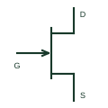

# N-channel JFET

A junction field-effect transistor using an N-type channel controlled through a gate junction.

[Canonical reference](https://eloragrid.ai/symbols/n-channel-jfet) · [Structured record](../entries/n-channel-jfet.json) · [All references](README.md)

Updated: 2026-10-27. Drawing use: Schematic. Reference families: Manufacturer.

## What it represents

A junction field-effect transistor using an N-type channel controlled through a gate junction.
On a schematic, identify the gate bias and drain/source connections and trace the analogue switch or amplifier signal path. Keep the component tag and signal/reference names consistent across the control drawing, terminal schedule and device documentation.
A JFET gate is a semiconductor junction, unlike the insulated gate of a MOSFET.
Terminal letters describe electrical roles, not package pin numbers. Check the selected public datasheet for the actual pin assignment, polarity and any internally connected terminals before completing the drawing.

## How to read it

- Identify the gate bias and drain/source connections.
- Trace the analogue switch or amplifier signal path.

## Drawing checklist

- Label the gate bias and drain/source connections.
- Cross-reference the analogue switch or amplifier signal path.
- Add the selected device or circuit documentation revision, power/reference connections and project signal convention.

## Important distinction

A JFET gate is a semiconductor junction, unlike the insulated gate of a MOSFET.

## Facts

- Common schematic mnemonic: N-JFET — descriptive only; project/device documentation defines reference designations.
- Terminal / interface focus: The gate bias and drain/source connections
- Artwork scope: Original educational component glyph; not a certified standard graphic or package pinout.

## Public references

- [J111/J112 JFET chopper transistor documentation](https://www.onsemi.com/pdf/datasheet/j111-d.pdf) — onsemi. Public primary manufacturer documentation establishes the component function or circuit/topology relationship. Preview geometry and drafting explanations are independently authored.

## Related references

- [N-channel enhancement MOSFET](n-channel-enhancement-mosfet.md)
- [Diode](diode.md)

Original educational concept geometry, CC BY 4.0. Unitless; not a certified standards glyph or manufacturer footprint.

Elora-authored explanations are CC BY 4.0. Linked standards and manufacturer material retain their own rights. Confirm project requirements using primary sources.
