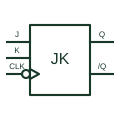

# Negative-edge JK flip-flop

Updates or toggles its stored state from J and K inputs at the selected negative clock edge.

[Canonical reference](https://eloragrid.ai/symbols/negative-edge-jk-flip-flop) · [Structured record](../entries/negative-edge-jk-flip-flop.json) · [All references](README.md)

Updated: 2026-10-27. Drawing use: Schematic. Reference families: Manufacturer.

## What it represents

Updates or toggles its stored state from J and K inputs at the selected negative clock edge.
On a schematic, identify the J/K inputs, clock polarity and asynchronous controls and trace the Q/complemented outputs and feedback connections. Keep the component tag and signal/reference names consistent across the control drawing, terminal schedule and device documentation.
JK input combinations define hold, set, reset or toggle behaviour; the clock-edge indication must match the selected device.
The preview is an independently drawn educational functional reference. Add the selected component’s actual power pins, terminal numbers, timing or analogue reference details when producing a construction drawing.

## How to read it

- Identify the J/K inputs, clock polarity and asynchronous controls.
- Trace the Q/complemented outputs and feedback connections.

## Drawing checklist

- Label the J/K inputs, clock polarity and asynchronous controls.
- Cross-reference the Q/complemented outputs and feedback connections.
- Add the selected device or circuit documentation revision, power/reference connections and project signal convention.

## Important distinction

JK input combinations define hold, set, reset or toggle behaviour; the clock-edge indication must match the selected device.

## Facts

- Common schematic mnemonic: JK-FF — descriptive only; project/device documentation defines reference designations.
- Terminal / interface focus: The J/K inputs, clock polarity and asynchronous controls
- Artwork scope: Original educational functional/circuit reference; not a selected product pinout.

## Public references

- [SN74HC112 — negative-edge JK flip-flops](https://www.ti.com/lit/ds/symlink/sn74hc112.pdf) — Texas Instruments. Public primary manufacturer documentation establishes the component function or circuit/topology relationship. Preview geometry and drafting explanations are independently authored.

## Related references

- [Positive-edge D flip-flop](positive-edge-d-flip-flop.md)
- [PLC input / output](plc-io.md)

Original educational concept geometry, CC BY 4.0. Unitless; not a certified standards glyph or manufacturer footprint.

Elora-authored explanations are CC BY 4.0. Linked standards and manufacturer material retain their own rights. Confirm project requirements using primary sources.
