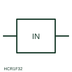

# Neutral-current measuring relay

Measuring relay fed from a CT in a neutral conductor or star-point connection, responding to neutral current.

[Canonical reference](https://eloragrid.ai/symbols/neutral-current-relay) · [Structured record](../entries/neutral-current-relay.json) · [All references](README.md)

Updated: 2026-10-28. Drawing use: Schematic, SLD. Reference families: IEC, Manufacturer.

## What it represents

This relay form is used where a CT is installed in a neutral conductor or in the earthing connection of a transformer or generator star point. Current there indicates earth faults or, in four-wire systems, heavy unbalance and triplen harmonic loading, depending on where the CT sits.
The symbol identifies the measured conductor but not the purpose. A neutral CT in the star-point earth lead gives standby earth-fault protection, while one in the four-wire neutral of a feeder sees load unbalance as well, so settings and grading differ greatly.

## How to read it

- Confirm whether the CT is in the neutral conductor or the earthing lead.
- Check grading against downstream earth-fault devices.

## Drawing checklist

- Show neutral CT location
- State setting and delay
- Reference grading study

## Important distinction

A neutral-current relay measures one neutral path; a residual connection sums the three phase CTs to derive the same quantity.

## Facts

- Measured quantity: Current in a neutral or star-point conductor
- Publisher reference token: HCR1F32 (Autodesk identifier; not an IEC database ID)
- Preview: Independent educational concept; consult the publisher and applicable standard for the exact graphic

## Public references

- [AutoCAD Electrical: Current monitoring relays](https://help.autodesk.com/cloudhelp/2021/ENU/AutoCAD-Electrical/files/GUID-E0DDA638-4664-4F1E-B191-29A4C40C4A0A.htm) — Autodesk. Public AutoCAD Electrical relay listing that names the In Neutral block; the illustration is independently drawn.
- [IEC graphical symbols for diagrams](https://tc3.iec.ch/tc-activity/graphical-symbols-for-diagrams/) — IEC. IEC context for graphical symbols used in diagrams; no IEC graphic is reproduced.

## Related references

- [Residual connection of phase CTs](residual-connection-of-phase-cts.md)
- [Earth-fault current relay](earth-fault-current-relay.md)
- [Time overcurrent](51-time-overcurrent.md)

Original educational concept geometry, CC BY 4.0. Unitless; not a certified standards glyph or manufacturer footprint.

Elora-authored explanations are CC BY 4.0. Linked standards and manufacturer material retain their own rights. Confirm project requirements using primary sources.
