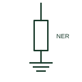

# Neutral earthing resistor

A resistor between a transformer or generator neutral and earth that limits earth-fault current to a set value.

[Canonical reference](https://eloragrid.ai/symbols/neutral-earthing-resistor) · [Structured record](../entries/neutral-earthing-resistor.json) · [All references](README.md)

Updated: 2026-10-28. Drawing use: SLD, Schematic. Reference families: IEC, IEEE / ANSI.

## What it represents

A neutral earthing resistor connects the star point of a transformer or generator to earth through a defined resistance. It limits earth-fault current, typically to tens or hundreds of amperes on medium-voltage systems and a few amperes on high-resistance earthed low-voltage systems, reducing damage and arc energy while keeping enough current for protection to detect.
Drawings show a resistor between the neutral of a star winding and the earth symbol, often with a current transformer in the neutral lead for earth-fault protection and sometimes a disconnector. The resistor current and time rating, such as 400 A for 10 seconds, are written beside it.
The symbol does not show the resistor's monitoring, which some designs use to detect an open resistor. It also does not show whether generator and transformer neutrals are earthed at the same time, which affects fault current and circulating harmonic currents.

## How to read it

- Read the current and time rating together.
- A neutral CT normally feeds earth-fault protection.

## Drawing checklist

- State resistance, current and time rating.
- Show neutral CT and disconnector.
- Reference earth-fault protection settings.

## Important distinction

A neutral earthing resistor limits fault current resistively; an arc suppression coil compensates capacitive fault current with inductance.

## Facts

- Connection: Neutral to earth
- Rating: Current and time, for example 400 A 10 s
- Associated protection: Neutral CT earth-fault relay
- Preview: Independent educational illustration; consult the applicable standard and project legend for the exact graphic

## Public references

- [Neutral grounding resistor and transformer resources](https://www.postglover.com/literature-library/) — Post Glover. Public neutral earthing resistor resource library.
- [Residual current and neutral-earthing protection context](https://new.abb.com/medium-voltage/digital-substations/campaigns/earth-fault-protection-portfolio/earth-fault-offering) — ABB. Public neutral earthing and earth-fault protection context.

## Related references

- [Star winding with accessible neutral](star-winding-with-accessible-neutral.md)
- [Arc suppression coil](arc-suppression-coil.md)
- [Time neutral-overcurrent protection](51n-time-neutral-overcurrent-protection.md)
- [Neutral earthing resistor cabinet](ga-neutral-earthing-resistor-cabinet.md)

Original educational concept geometry, CC BY 4.0. Unitless; not a certified standards glyph or manufacturer footprint.

Elora-authored explanations are CC BY 4.0. Linked standards and manufacturer material retain their own rights. Confirm project requirements using primary sources.
