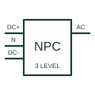

# Neutral-point-clamped inverter

A multilevel switching arrangement using the documented split DC link and neutral-point clamping paths.

[Canonical reference](https://eloragrid.ai/symbols/neutral-point-clamped-inverter) · [Structured record](../entries/neutral-point-clamped-inverter.json) · [All references](README.md)

Updated: 2026-10-27. Drawing use: Schematic, SLD. Reference families: Manufacturer.

## What it represents

A multilevel switching arrangement using the documented split DC link and neutral-point clamping paths.
On a schematic, identify the split-link midpoint, clamping devices and phase-leg switches and trace the phase output and DC-link balancing/control references. Keep the component tag and signal/reference names consistent across the control drawing, terminal schedule and device documentation.
NPC identifies a specific multilevel arrangement; active-NPC variants replace parts of the clamping arrangement and need separate device documentation.
The preview is a conceptual topology reference rather than a complete power-stage circuit. Switching sequences, magnetic design, component selection and control/protection details belong in the equipment design documentation.

## How to read it

- Identify the split-link midpoint, clamping devices and phase-leg switches.
- Trace the phase output and DC-link balancing/control references.

## Drawing checklist

- Label the split-link midpoint, clamping devices and phase-leg switches.
- Cross-reference the phase output and DC-link balancing/control references.
- Add the selected device or circuit documentation revision, power/reference connections and project signal convention.

## Important distinction

NPC identifies a specific multilevel arrangement; active-NPC variants replace parts of the clamping arrangement and need separate device documentation.

## Facts

- Common schematic mnemonic: NPC — descriptive only; project/device documentation defines reference designations.
- Terminal / interface focus: The split-link midpoint, clamping devices and phase-leg switches
- Artwork scope: Original conceptual topology block; not a complete switch-level circuit.

## Public references

- [Multilevel NPC converter application context](https://www.infineon.com/product-information/sic-modules-for-ups-design-and-efficiency-guide) — Infineon Technologies. Public primary manufacturer documentation establishes the component function or circuit/topology relationship. Preview geometry and drafting explanations are independently authored.

## Related references

- [Three-phase voltage-source inverter](three-phase-voltage-source-inverter.md)
- [Power converter / inverter](power-converter.md)

Original educational concept geometry, CC BY 4.0. Unitless; not a certified standards glyph or manufacturer footprint.

Elora-authored explanations are CC BY 4.0. Linked standards and manufacturer material retain their own rights. Confirm project requirements using primary sources.
