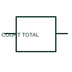

# Non-resettable counter relay

A non-resettable counter records events without a normal user reset function.

[Canonical reference](https://eloragrid.ai/symbols/non-resettable-counter-relay) · [Structured record](../entries/non-resettable-counter-relay.json) · [All references](README.md)

Updated: 2026-10-27. Drawing use: Schematic. Reference families: IEC, Manufacturer.

## What it represents

A non-resettable counter records events without a normal user reset function. It is used where the total event history is part of the documented equipment indication.

## How to read it

- Check the specified retention behaviour when the auxiliary supply is lost.
- The preview is an original explanation of this function. Match the actual drawing convention to its legend and the selected equipment documentation.

## Drawing checklist

- Define qualifying event
- State counter supply
- Reference retention and rollover

## Important distinction

A totalising counter is different from a preset counter intended to be reset each operating cycle.

## Facts

- Drawing role: Relay operation
- Representation scope: Functional concept; not an official standard graphic or a product footprint
- Public vendor block reference: HCR1CNN, VCR1CNN (Autodesk identifiers; not IEC symbol numbers)
- Identifier status: The short label is a functional lookup label, not an assigned IEC or IEEE symbol number. Any separately listed Autodesk code is a verified vendor block name.

## Public references

- [AutoCAD Electrical: Counter relays](https://help.autodesk.com/cloudhelp/2021/ENU/AutoCAD-Electrical/files/GUID-EDA5C048-228A-4ABF-B77B-D305F4BB656A.htm) — Autodesk. Public documentation of this equipment function or named vendor variant; the illustration is independently authored and is not the source graphic.

## Related references

- [Relay coil](relay-coil.md)
- [Normally open contact](normally-open-contact.md)

Original educational concept geometry, CC BY 4.0. Unitless; not a certified standards glyph or manufacturer footprint.

Elora-authored explanations are CC BY 4.0. Linked standards and manufacturer material retain their own rights. Confirm project requirements using primary sources.
