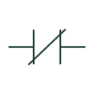

# Normally closed contact

A contact shown closed in the normal state defined for its device.

[Canonical reference](https://eloragrid.ai/symbols/normally-closed-contact) · [Structured record](../entries/normally-closed-contact.json) · [All references](README.md)

Updated: 2026-10-27. Drawing use: Schematic. Reference families: IEC, IEEE / ANSI.

## What it represents

A normally closed contact is closed in the normal state specified for its device. Actuating the parent device may open it. The drawing must establish that state convention and associate the contact with the appropriate equipment and terminal designations.
NC contacts occur in relay logic, indication and control circuits. The contact representation alone does not establish safety behaviour, failure response or suitability for a safety function. Those properties depend on the complete device and system design.

## How to read it

- Follow the parent-device reference and the relevant circuit path.
- Check whether the drawing describes a de-energised, unactuated or explicitly stated operating state.

## Drawing checklist

- Reference the parent device.
- Document the contact terminals.
- Explain any state convention that differs from the general legend.

## Important distinction

An NC mark does not prove a circuit is fail-safe or establish positive-opening characteristics. Consult the selected device and complete control design.

## Facts

- Normal state: Closed, as defined for the parent device
- Safety characteristics: Not established by the generic symbol
- Device association: Parent identifier and terminals
- Public Autodesk reference names: HCR22, VCR22 (vendor identifiers, not IEC symbol IDs)

## Public references

- [Relays and contacts: public symbol reference](https://help.autodesk.com/cloudhelp/2021/ENU/AutoCAD-Electrical/files/GUID-011C62B8-9EC8-485C-B47D-B22A3F7B7574.htm) — Autodesk. Public normally closed relay contact categories.

## Related references

- [Normally open contact](normally-open-contact.md)
- [Changeover contact](changeover-contact.md)
- [Relay coil](relay-coil.md)
- [Emergency-stop operator](emergency-stop.md)

Original educational concept geometry, CC BY 4.0. Unitless; not a certified standards glyph or manufacturer footprint.

Elora-authored explanations are CC BY 4.0. Linked standards and manufacturer material retain their own rights. Confirm project requirements using primary sources.
