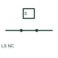

# Normally-closed limit switch

A normally-closed limit switch opens when the documented mechanical position actuates it.

[Canonical reference](https://eloragrid.ai/symbols/normally-closed-limit-switch) · [Structured record](../entries/normally-closed-limit-switch.json) · [All references](README.md)

Updated: 2026-10-27. Drawing use: Schematic. Reference families: IEC, Manufacturer.

## What it represents

A normally-closed limit switch opens when the documented mechanical position actuates it. The reference position must be stated so the logic is interpretable during rest and travel.

## How to read it

- Trace the circuit in both actuated and unactuated states.
- The preview is an original explanation of this function. Match the actual drawing convention to its legend and the selected equipment documentation.

## Drawing checklist

- Define normal position
- Identify actuating travel
- Show reset or return condition

## Important distinction

Normally closed does not by itself establish fault detection or a safety function.

## Facts

- Drawing role: Actuated indication
- Representation scope: Functional concept; not an official standard graphic or a product footprint
- Public vendor block reference: HLS12, VLS12 (Autodesk identifiers; not IEC symbol numbers)
- Identifier status: The short label is a functional lookup label, not an assigned IEC or IEEE symbol number. Any separately listed Autodesk code is a verified vendor block name.

## Public references

- [AutoCAD Electrical: Limit switches](https://help.autodesk.com/cloudhelp/2021/ENU/AutoCAD-Electrical/files/GUID-3CF4BE45-A302-4757-B5C9-C1AFF9BDC512.htm) — Autodesk. Public documentation of this equipment function or named vendor variant; the illustration is independently authored and is not the source graphic.

## Related references

- [PLC input / output](plc-io.md)
- [Normally open contact](normally-open-contact.md)

Original educational concept geometry, CC BY 4.0. Unitless; not a certified standards glyph or manufacturer footprint.

Elora-authored explanations are CC BY 4.0. Linked standards and manufacturer material retain their own rights. Confirm project requirements using primary sources.
