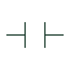

# Normally open contact

A contact shown open in the normal state defined for its device.

[Canonical reference](https://eloragrid.ai/symbols/normally-open-contact) · [Structured record](../entries/normally-open-contact.json) · [All references](README.md)

Updated: 2026-10-27. Drawing use: Schematic. Reference families: IEC, IEEE / ANSI.

## What it represents

A normally open contact is open in the normal state defined for the device. Operating its relay, pushbutton or other parent device may close the contact. The meaning of normal must be established from the drawing convention and equipment documentation; it is not necessarily the current live condition of the installation.
A schematic usually identifies the parent device and the relevant terminals. Several contact representations can belong to one relay or contactor. Cross-references connect those representations to their coil or parent equipment.

## How to read it

- Read the parent device identifier before interpreting the contact function.
- Check the terminal identifiers and the state convention in the drawing legend.

## Drawing checklist

- Identify the parent coil or actuator.
- Use the documented terminal designation.
- Cross-reference other contacts belonging to the same device.

## Important distinction

Normally open describes the stated normal condition. A position indication or operating snapshot may use a different state convention.

## Facts

- Normal state: Open, as defined for the parent device
- Terminal designation: Manufacturer-specific
- Parent relationship: Coil, actuator or equipment cross-reference
- Public Autodesk reference names: HCR21, VCR21 (vendor identifiers, not IEC symbol IDs)

## Public references

- [Relays and contacts: public symbol reference](https://help.autodesk.com/cloudhelp/2021/ENU/AutoCAD-Electrical/files/GUID-011C62B8-9EC8-485C-B47D-B22A3F7B7574.htm) — Autodesk. Public normally open relay contact categories.

## Related references

- [Normally closed contact](normally-closed-contact.md)
- [Changeover contact](changeover-contact.md)
- [Relay coil](relay-coil.md)
- [Normally open pushbutton](pushbutton-no.md)

Original educational concept geometry, CC BY 4.0. Unitless; not a certified standards glyph or manufacturer footprint.

Elora-authored explanations are CC BY 4.0. Linked standards and manufacturer material retain their own rights. Confirm project requirements using primary sources.
