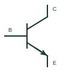

# NPN bipolar transistor

A bipolar transistor with base, collector and emitter terminals arranged for NPN operation.

[Canonical reference](https://eloragrid.ai/symbols/npn-bipolar-transistor) · [Structured record](../entries/npn-bipolar-transistor.json) · [All references](README.md)

Updated: 2026-10-27. Drawing use: Schematic. Reference families: Manufacturer.

## What it represents

A bipolar transistor with base, collector and emitter terminals arranged for NPN operation.
On a schematic, identify the base drive, collector node and emitter reference and trace the switched or amplified collector circuit. Keep the component tag and signal/reference names consistent across the control drawing, terminal schedule and device documentation.
The emitter arrow distinguishes NPN from PNP in common schematics; the package pin order must still come from the selected part.
Terminal letters describe electrical roles, not package pin numbers. Check the selected public datasheet for the actual pin assignment, polarity and any internally connected terminals before completing the drawing.

## How to read it

- Identify the base drive, collector node and emitter reference.
- Trace the switched or amplified collector circuit.

## Drawing checklist

- Label the base drive, collector node and emitter reference.
- Cross-reference the switched or amplified collector circuit.
- Add the selected device or circuit documentation revision, power/reference connections and project signal convention.

## Important distinction

The emitter arrow distinguishes NPN from PNP in common schematics; the package pin order must still come from the selected part.

## Facts

- Common schematic mnemonic: NPN — descriptive only; project/device documentation defines reference designations.
- Terminal / interface focus: The base drive, collector node and emitter reference
- Artwork scope: Original educational component glyph; not a certified standard graphic or package pinout.

## Public references

- [BC847 NPN transistor documentation](https://assets.nexperia.com/documents/data-sheet/BC847X_SER.pdf) — Nexperia. Public primary manufacturer documentation establishes the component function or circuit/topology relationship. Preview geometry and drafting explanations are independently authored.

## Related references

- [PNP bipolar transistor](pnp-bipolar-transistor.md)
- [Diode](diode.md)

Original educational concept geometry, CC BY 4.0. Unitless; not a certified standards glyph or manufacturer footprint.

Elora-authored explanations are CC BY 4.0. Linked standards and manufacturer material retain their own rights. Confirm project requirements using primary sources.
