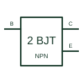

# NPN Darlington transistor

Two NPN transistor stages connected as a Darlington pair to provide a combined current-amplifying device.

[Canonical reference](https://eloragrid.ai/symbols/npn-darlington-transistor) · [Structured record](../entries/npn-darlington-transistor.json) · [All references](README.md)

Updated: 2026-10-27. Drawing use: Schematic. Reference families: Manufacturer.

## What it represents

Two NPN transistor stages connected as a Darlington pair to provide a combined current-amplifying device.
On a schematic, identify the common collector, input base and output emitter and trace the load and base-drive circuit. Keep the component tag and signal/reference names consistent across the control drawing, terminal schedule and device documentation.
A Darlington is a compound connection rather than a single ordinary NPN transistor; its voltage drops and switching behaviour require the device data.
The preview is an independently drawn educational functional reference. Add the selected component’s actual power pins, terminal numbers, timing or analogue reference details when producing a construction drawing.

## How to read it

- Identify the common collector, input base and output emitter.
- Trace the load and base-drive circuit.

## Drawing checklist

- Label the common collector, input base and output emitter.
- Cross-reference the load and base-drive circuit.
- Add the selected device or circuit documentation revision, power/reference connections and project signal convention.

## Important distinction

A Darlington is a compound connection rather than a single ordinary NPN transistor; its voltage drops and switching behaviour require the device data.

## Facts

- Common schematic mnemonic: NPN-DAR — descriptive only; project/device documentation defines reference designations.
- Terminal / interface focus: The common collector, input base and output emitter
- Artwork scope: Original educational functional/circuit reference; not a selected product pinout.

## Public references

- [TIP120/TIP125 complementary Darlington transistor documentation](https://www.st.com/resource/en/datasheet/tip120.pdf) — STMicroelectronics. Public primary manufacturer documentation establishes the component function or circuit/topology relationship. Preview geometry and drafting explanations are independently authored.

## Related references

- [NPN bipolar transistor](npn-bipolar-transistor.md)
- [Diode](diode.md)

Original educational concept geometry, CC BY 4.0. Unitless; not a certified standards glyph or manufacturer footprint.

Elora-authored explanations are CC BY 4.0. Linked standards and manufacturer material retain their own rights. Confirm project requirements using primary sources.
