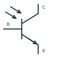

# NPN phototransistor

An NPN transistor whose collector-emitter conduction responds to incident light in the documented detector arrangement.

[Canonical reference](https://eloragrid.ai/symbols/npn-phototransistor) · [Structured record](../entries/npn-phototransistor.json) · [All references](README.md)

Updated: 2026-10-27. Drawing use: Schematic. Reference families: Manufacturer.

## What it represents

An NPN transistor whose collector-emitter conduction responds to incident light in the documented detector arrangement.
On a schematic, identify the collector/emitter connections and any accessible base terminal and trace the optical sensing and load circuit. Keep the component tag and signal/reference names consistent across the control drawing, terminal schedule and device documentation.
A phototransistor provides transistor action; a photodiode generates a different detector current response.
Terminal letters describe electrical roles, not package pin numbers. Check the selected public datasheet for the actual pin assignment, polarity and any internally connected terminals before completing the drawing.

## How to read it

- Identify the collector/emitter connections and any accessible base terminal.
- Trace the optical sensing and load circuit.

## Drawing checklist

- Label the collector/emitter connections and any accessible base terminal.
- Cross-reference the optical sensing and load circuit.
- Add the selected device or circuit documentation revision, power/reference connections and project signal convention.

## Important distinction

A phototransistor provides transistor action; a photodiode generates a different detector current response.

## Facts

- Common schematic mnemonic: PHOTO-NPN — descriptive only; project/device documentation defines reference designations.
- Terminal / interface focus: The collector/emitter connections and any accessible base terminal
- Artwork scope: Original educational component glyph; not a certified standard graphic or package pinout.

## Public references

- [BPW77 silicon NPN phototransistor documentation](https://www.vishay.com/docs/81527/bpw77n.pdf) — Vishay. Public primary manufacturer documentation establishes the component function or circuit/topology relationship. Preview geometry and drafting explanations are independently authored.

## Related references

- [Photodiode](photodiode.md)
- [Diode](diode.md)

Original educational concept geometry, CC BY 4.0. Unitless; not a certified standards glyph or manufacturer footprint.

Elora-authored explanations are CC BY 4.0. Linked standards and manufacturer material retain their own rights. Confirm project requirements using primary sources.
