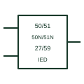

# Numerical protection relay (IED)

Single relay block on an SLD that lists the protection functions it provides, with CT, VT and trip connections.

[Canonical reference](https://eloragrid.ai/symbols/numerical-protection-relay) · [Structured record](../entries/numerical-protection-relay.json) · [All references](README.md)

Updated: 2026-10-28. Drawing use: SLD, Schematic. Reference families: IEC, Manufacturer.

## What it represents

A numerical protection relay, or IED, combines many protection, control and measuring functions in one device. Single-line diagrams draw it as a block connected to its CTs, VTs and breaker trip coil, with the enabled functions listed inside or beside it using IEC function symbols or ANSI device numbers.
Listing a function on the block shows it is enabled, not how it is set. The block does not show settings, logic between functions, or communications, so it must be read with the settings file and the protection logic diagram.

## How to read it

- Read the function list as enabled functions, not settings.
- Trace CT, VT and trip connections to the block.

## Drawing checklist

- List enabled functions
- Show CT, VT and trip connections
- Reference settings file

## Important distinction

An IED block represents a multifunction device; a single measuring relay symbol represents one function.

## Facts

- Content: Protection, control and measuring functions in one device
- Function labels: IEC symbols or ANSI device numbers
- Preview: Functional illustration of the device role; not a product footprint or certified standard graphic

## Public references

- [Relion 620: functions, codes and symbols](https://techdoc.relays.protection-control.abb/r/620-series-IEC-60870-5-103-Point-List-Manual/2.0-FP1-IEC/en-US/Functions-codes-and-symbols) — ABB. Public manufacturer list of relay functions with codes and symbols.
- [SEL 2022 Product and Solution Guide: published protection function tables](https://selinc.com/api/download/136012) — Schweitzer Engineering Laboratories. Public relay product guide with function tables.

## Related references

- [Measuring relay](measuring-relay.md)
- [Instantaneous overcurrent](50-instantaneous-overcurrent.md)
- [Trip-circuit supervision relay](trip-circuit-supervision-relay.md)

Original educational concept geometry, CC BY 4.0. Unitless; not a certified standards glyph or manufacturer footprint.

Elora-authored explanations are CC BY 4.0. Linked standards and manufacturer material retain their own rights. Confirm project requirements using primary sources.
