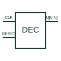

# Decoded decade counter

Advances a decoded output sequence through the documented ten-state counter arrangement.

[Canonical reference](https://eloragrid.ai/symbols/one-hot-decade-counter) · [Structured record](../entries/one-hot-decade-counter.json) · [All references](README.md)

Updated: 2026-10-27. Drawing use: Schematic. Reference families: Manufacturer.

## What it represents

Advances a decoded output sequence through the documented ten-state counter arrangement.
On a schematic, identify the clock, inhibit and reset controls and trace the decoded outputs and carry/cascade path. Keep the component tag and signal/reference names consistent across the control drawing, terminal schedule and device documentation.
Decoded decade outputs differ from a binary-coded ten-state word; the selected device's sequence table defines the actual mapping.
The preview is an independently drawn educational functional reference. Add the selected component’s actual power pins, terminal numbers, timing or analogue reference details when producing a construction drawing.

## How to read it

- Identify the clock, inhibit and reset controls.
- Trace the decoded outputs and carry/cascade path.

## Drawing checklist

- Label the clock, inhibit and reset controls.
- Cross-reference the decoded outputs and carry/cascade path.
- Add the selected device or circuit documentation revision, power/reference connections and project signal convention.

## Important distinction

Decoded decade outputs differ from a binary-coded ten-state word; the selected device's sequence table defines the actual mapping.

## Facts

- Common schematic mnemonic: DECADE — descriptive only; project/device documentation defines reference designations.
- Terminal / interface focus: The clock, inhibit and reset controls
- Artwork scope: Original educational functional/circuit reference; not a selected product pinout.

## Public references

- [CD4017B — decoded decade counters](https://www.ti.com/lit/ds/symlink/cd4017b.pdf) — Texas Instruments. Public primary manufacturer documentation establishes the component function or circuit/topology relationship. Preview geometry and drafting explanations are independently authored.

## Related references

- [Synchronous binary counter](synchronous-binary-counter.md)
- [PLC input / output](plc-io.md)

Original educational concept geometry, CC BY 4.0. Unitless; not a certified standards glyph or manufacturer footprint.

Elora-authored explanations are CC BY 4.0. Linked standards and manufacturer material retain their own rights. Confirm project requirements using primary sources.
