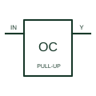

# Open-collector buffer

Provides a logic output through a transistor pull-down stage requiring the documented external load or pull-up.

[Canonical reference](https://eloragrid.ai/symbols/open-collector-buffer) · [Structured record](../entries/open-collector-buffer.json) · [All references](README.md)

Updated: 2026-10-27. Drawing use: Schematic. Reference families: Manufacturer.

## What it represents

Provides a logic output through a transistor pull-down stage requiring the documented external load or pull-up.
On a schematic, identify the logic supply, collector output and pull-up/load supply and trace the wired output signal and receiving input. Keep the component tag and signal/reference names consistent across the control drawing, terminal schedule and device documentation.
An open collector can sink current under its limits; it does not actively drive the high state like a push-pull output.
The preview is an independently drawn educational functional reference. Add the selected component’s actual power pins, terminal numbers, timing or analogue reference details when producing a construction drawing.

## How to read it

- Identify the logic supply, collector output and pull-up/load supply.
- Trace the wired output signal and receiving input.

## Drawing checklist

- Label the logic supply, collector output and pull-up/load supply.
- Cross-reference the wired output signal and receiving input.
- Add the selected device or circuit documentation revision, power/reference connections and project signal convention.

## Important distinction

An open collector can sink current under its limits; it does not actively drive the high state like a push-pull output.

## Facts

- Common schematic mnemonic: OC-BUF — descriptive only; project/device documentation defines reference designations.
- Terminal / interface focus: The logic supply, collector output and pull-up/load supply
- Artwork scope: Original educational functional/circuit reference; not a selected product pinout.

## Public references

- [SN74LS07 — open-collector output buffers](https://www.ti.com/lit/ds/symlink/sn74ls07.pdf) — Texas Instruments. Public primary manufacturer documentation establishes the component function or circuit/topology relationship. Preview geometry and drafting explanations are independently authored.

## Related references

- [Three-state logic buffer](logic-three-state-buffer.md)
- [PLC input / output](plc-io.md)

Original educational concept geometry, CC BY 4.0. Unitless; not a certified standards glyph or manufacturer footprint.

Elora-authored explanations are CC BY 4.0. Linked standards and manufacturer material retain their own rights. Confirm project requirements using primary sources.
