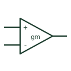

# Operational transconductance amplifier

Produces an output current controlled by its differential input voltage and documented bias arrangement.

[Canonical reference](https://eloragrid.ai/symbols/operational-transconductance-amplifier) · [Structured record](../entries/operational-transconductance-amplifier.json) · [All references](README.md)

Updated: 2026-10-27. Drawing use: Schematic. Reference families: Manufacturer.

## What it represents

Produces an output current controlled by its differential input voltage and documented bias arrangement.
On a schematic, identify the differential inputs, bias-current control and output-current node and trace the current-mode signal or controlled filter/amplifier circuit. Keep the component tag and signal/reference names consistent across the control drawing, terminal schedule and device documentation.
Transconductance relates input voltage to output current; it differs from an ordinary voltage-output op amp.
Terminal letters describe electrical roles, not package pin numbers. Check the selected public datasheet for the actual pin assignment, polarity and any internally connected terminals before completing the drawing.

## How to read it

- Identify the differential inputs, bias-current control and output-current node.
- Trace the current-mode signal or controlled filter/amplifier circuit.

## Drawing checklist

- Label the differential inputs, bias-current control and output-current node.
- Cross-reference the current-mode signal or controlled filter/amplifier circuit.
- Add the selected device or circuit documentation revision, power/reference connections and project signal convention.

## Important distinction

Transconductance relates input voltage to output current; it differs from an ordinary voltage-output op amp.

## Facts

- Common schematic mnemonic: OTA — descriptive only; project/device documentation defines reference designations.
- Terminal / interface focus: The differential inputs, bias-current control and output-current node
- Artwork scope: Original educational component glyph; not a certified standard graphic or package pinout.

## Public references

- [LM13700 — operational transconductance amplification](https://www.ti.com/product/LM13700) — Texas Instruments. Public primary manufacturer documentation establishes the component function or circuit/topology relationship. Preview geometry and drafting explanations are independently authored.

## Related references

- [Operational amplifier](operational-amplifier.md)
- [PLC input / output](plc-io.md)

Original educational concept geometry, CC BY 4.0. Unitless; not a certified standards glyph or manufacturer footprint.

Elora-authored explanations are CC BY 4.0. Linked standards and manufacturer material retain their own rights. Confirm project requirements using primary sources.
