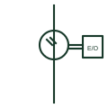

# Optical current sensor

Current sensor using light in an optical fibre around the conductor, whose polarisation changes with the magnetic field.

[Canonical reference](https://eloragrid.ai/symbols/optical-current-sensor) · [Structured record](../entries/optical-current-sensor.json) · [All references](README.md)

Updated: 2026-10-28. Drawing use: SLD. Reference families: IEC, Manufacturer.

## What it represents

An optical current sensor measures current from the rotation of polarised light in a fibre wound around the conductor, a magneto-optic effect proportional to the enclosed magnetic field. It is used in HV and DC applications where conventional CTs are bulky or where saturation and insulation are concerns.
The sensor head connects through fibre to an electronics unit, which usually outputs digital sampled values to protection and metering devices. The symbol does not show the electronics unit, its supply or the data interface, all of which must be drawn for the measurement chain to be complete.

## How to read it

- Find the electronics unit that converts the optical signal.
- Check the data interface to protection devices.

## Drawing checklist

- Show sensor head and electronics
- Reference output interface
- State auxiliary supply

## Important distinction

An optical current sensor uses light in fibre; a conventional CT uses magnetic induction in a winding.

## Facts

- Principle: Magneto-optic rotation of polarised light
- Output: Usually digital via an electronics unit
- Preview: Functional illustration of the device role; not a product footprint or certified standard graphic

## Public references

- [Indoor current and voltage transformers](https://www.abb.com/gb/en/areas/electrification/medium-voltage/grid-components/core-components/indoor-instrument-transformers) — ABB. Public manufacturer overview of indoor current and voltage instrument transformers.
- [IEC graphical symbols for diagrams](https://tc3.iec.ch/tc-activity/graphical-symbols-for-diagrams/) — IEC. IEC context for graphical symbols used in diagrams; no IEC graphic is reproduced.

## Related references

- [Rogowski coil current sensor](rogowski-coil.md)
- [Low-power current transformer](low-power-current-transformer.md)
- [Current transformer](current-transformer.md)

Original educational concept geometry, CC BY 4.0. Unitless; not a certified standards glyph or manufacturer footprint.

Elora-authored explanations are CC BY 4.0. Linked standards and manufacturer material retain their own rights. Confirm project requirements using primary sources.
