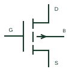

# P-channel enhancement MOSFET

An insulated-gate transistor using a P-channel and the corresponding gate-to-source drive polarity.

[Canonical reference](https://eloragrid.ai/symbols/p-channel-enhancement-mosfet) · [Structured record](../entries/p-channel-enhancement-mosfet.json) · [All references](README.md)

Updated: 2026-10-27. Drawing use: Schematic. Reference families: Manufacturer.

## What it represents

An insulated-gate transistor using a P-channel and the corresponding gate-to-source drive polarity.
On a schematic, identify the source supply, gate-drive reference and drain load and trace the controlled current path and body-diode orientation. Keep the component tag and signal/reference names consistent across the control drawing, terminal schedule and device documentation.
P-channel gate drive is referenced to its own source; a flipped N-channel symbol is not an equivalent part.
Terminal letters describe electrical roles, not package pin numbers. Check the selected public datasheet for the actual pin assignment, polarity and any internally connected terminals before completing the drawing.

## How to read it

- Identify the source supply, gate-drive reference and drain load.
- Trace the controlled current path and body-diode orientation.

## Drawing checklist

- Label the source supply, gate-drive reference and drain load.
- Cross-reference the controlled current path and body-diode orientation.
- Add the selected device or circuit documentation revision, power/reference connections and project signal convention.

## Important distinction

P-channel gate drive is referenced to its own source; a flipped N-channel symbol is not an equivalent part.

## Facts

- Common schematic mnemonic: P-MOS — descriptive only; project/device documentation defines reference designations.
- Terminal / interface focus: The source supply, gate-drive reference and drain load
- Artwork scope: Original educational component glyph; not a certified standard graphic or package pinout.

## Public references

- [MOSFET families and application documentation](https://www.nexperia.com/products/mosfets) — Nexperia. Public primary manufacturer documentation establishes the component function or circuit/topology relationship. Preview geometry and drafting explanations are independently authored.

## Related references

- [N-channel enhancement MOSFET](n-channel-enhancement-mosfet.md)
- [Diode](diode.md)

Original educational concept geometry, CC BY 4.0. Unitless; not a certified standards glyph or manufacturer footprint.

Elora-authored explanations are CC BY 4.0. Linked standards and manufacturer material retain their own rights. Confirm project requirements using primary sources.
