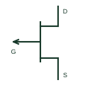

# P-channel JFET

A junction field-effect transistor using a P-type channel and the corresponding gate-bias polarity.

[Canonical reference](https://eloragrid.ai/symbols/p-channel-jfet) · [Structured record](../entries/p-channel-jfet.json) · [All references](README.md)

Updated: 2026-10-27. Drawing use: Schematic. Reference families: Manufacturer.

## What it represents

A junction field-effect transistor using a P-type channel and the corresponding gate-bias polarity.
On a schematic, identify the gate junction polarity and drain/source references and trace the analogue control or amplifier path. Keep the component tag and signal/reference names consistent across the control drawing, terminal schedule and device documentation.
P-channel and N-channel JFETs use opposite gate-bias polarity; the arrow and manufacturer terminal diagram resolve the type.
Terminal letters describe electrical roles, not package pin numbers. Check the selected public datasheet for the actual pin assignment, polarity and any internally connected terminals before completing the drawing.

## How to read it

- Identify the gate junction polarity and drain/source references.
- Trace the analogue control or amplifier path.

## Drawing checklist

- Label the gate junction polarity and drain/source references.
- Cross-reference the analogue control or amplifier path.
- Add the selected device or circuit documentation revision, power/reference connections and project signal convention.

## Important distinction

P-channel and N-channel JFETs use opposite gate-bias polarity; the arrow and manufacturer terminal diagram resolve the type.

## Facts

- Common schematic mnemonic: P-JFET — descriptive only; project/device documentation defines reference designations.
- Terminal / interface focus: The gate junction polarity and drain/source references
- Artwork scope: Original educational component glyph; not a certified standard graphic or package pinout.

## Public references

- [JFET master table with explicit P-channel device classification](https://interfet.com/jfet-master-table/) — InterFET. Public primary manufacturer documentation establishes the component function or circuit/topology relationship. Preview geometry and drafting explanations are independently authored.

## Related references

- [N-channel JFET](n-channel-jfet.md)
- [Diode](diode.md)

Original educational concept geometry, CC BY 4.0. Unitless; not a certified standards glyph or manufacturer footprint.

Elora-authored explanations are CC BY 4.0. Linked standards and manufacturer material retain their own rights. Confirm project requirements using primary sources.
