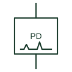

# Partial discharge sensor

Sensor on switchgear, cables or transformers that picks up signals from partial discharge for insulation condition monitoring.

[Canonical reference](https://eloragrid.ai/symbols/partial-discharge-sensor) · [Structured record](../entries/partial-discharge-sensor.json) · [All references](README.md)

Updated: 2026-10-28. Drawing use: SLD, Schematic. Reference families: Manufacturer.

## What it represents

Partial discharge sensors detect small electrical discharges inside insulation before it fails. Common types include transient earth voltage sensors on metal-clad switchgear, UHF antennas in gas-insulated equipment and high-frequency CTs on cable earth straps, each feeding a monitoring unit that records and trends the activity.
The symbol shows the sensor location but not its type or frequency range, and results from different sensor types are not directly comparable. Monitoring is used for maintenance decisions rather than protection, so the sensor output normally goes to alarms or a condition monitoring system rather than a trip circuit.

## How to read it

- Identify the sensor type at each location.
- Confirm outputs go to monitoring rather than tripping.

## Drawing checklist

- State sensor type
- Show location on equipment
- Reference monitoring unit

## Important distinction

A partial discharge sensor assesses insulation condition; an insulation monitoring relay measures insulation resistance of an unearthed system.

## Facts

- Sensor types: TEV, UHF and high-frequency CT
- Purpose: Insulation condition monitoring
- Preview: Functional illustration of the device role; not a product footprint or certified standard graphic

## Public references

- [Secondary-distribution switchgear and ring main units](https://new.abb.com/medium-voltage/switchgear/secondary-distribution) — ABB. Public switchgear context in which insulation condition monitoring is applied.
- [Electrical and physical sensing functions](https://www.ti.com/technologies/sensing.html) — Texas Instruments. Public overview of electrical sensing functions.

## Related references

- [Insulation monitoring relay](insulation-monitoring-relay.md)
- [Switchgear panel](switchgear-panel.md)
- [Voltage presence indicating system](voltage-presence-indicator.md)

Original educational concept geometry, CC BY 4.0. Unitless; not a certified standards glyph or manufacturer footprint.

Elora-authored explanations are CC BY 4.0. Linked standards and manufacturer material retain their own rights. Confirm project requirements using primary sources.
