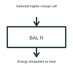

# Passive battery cell balancer

A passive balancer removes some energy from selected cells through a dissipative path.

[Canonical reference](https://eloragrid.ai/symbols/passive-cell-balancer) · [Structured record](../entries/passive-cell-balancer.json) · [All references](README.md)

Updated: 2026-10-27. Drawing use: Schematic. Reference families: Manufacturer.

## What it represents

A passive balancer removes some energy from selected cells through a dissipative path.
A balancing circuit can use a resistor to reduce the charge of a selected cell relative to others.
Draw the balancing branch beside the cell that it can discharge. Passive balancing deliberately turns some stored energy into heat to reduce a selected cell’s charge relative to others. A conceptual diagram should therefore show a dissipative branch, rather than arrows moving energy into a neighbouring cell. This is original functional artwork, not a certified standard graphic or device pinout.

## How to read it

- Identify the cells with balancing branches.
- Reference balancing control and thermal requirements.
- Keep balancing current separate from the pack load path.
- Passive balancing dissipates energy; it does not transfer that energy to another cell.

## Drawing checklist

- Identify the cells with balancing branches.
- Reference balancing control and thermal requirements.
- Keep balancing current separate from the pack load path.

## Important distinction

Passive balancing dissipates energy; it does not transfer that energy to another cell.

## Facts

- Representation type: Original functional block; not a certified IEC or IEEE graphic
- Concept input: Selected higher-charge cell
- Concept output: Energy dissipated as heat

## Public references

- [Battery monitors and balancers](https://www.ti.com/product-category/battery-management-ics/battery-monitors-balancers/overview.html) — Texas Instruments. Battery monitors and balancers: public technical context for the named function. Product and compliance details remain with the publisher.

## Related references

- [Battery storage cabinet](battery-cabinet.md)
- [Battery cell voltage monitor](battery-cell-voltage-monitor.md)
- [Active battery cell balancer](active-cell-balancer.md)
- [Battery cell temperature monitor](battery-cell-temperature-monitor.md)

Original educational concept geometry, CC BY 4.0. Unitless; not a certified standards glyph or manufacturer footprint.

Elora-authored explanations are CC BY 4.0. Linked standards and manufacturer material retain their own rights. Confirm project requirements using primary sources.
