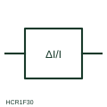

# Percentage-biased differential current relay

Differential relay form whose operating threshold rises in proportion to the through current, set as a relative value.

[Canonical reference](https://eloragrid.ai/symbols/percentage-differential-current-relay) · [Structured record](../entries/percentage-differential-current-relay.json) · [All references](README.md)

Updated: 2026-10-28. Drawing use: Schematic, SLD. Reference families: IEC, Manufacturer.

## What it represents

This relay form represents differential protection where the operate quantity is the difference between currents entering and leaving a zone, and the threshold is a percentage of the through current. The bias keeps the relay stable when CT errors grow during heavy external faults or transformer tap changes.
On a drawing the relay box is fed from CT sets at each boundary of the protected zone. The symbol does not show the slope settings, the harmonic restraint used for transformer inrush, or the vector-group and ratio compensation, all of which must be taken from the relay settings record.

## How to read it

- Locate every CT set that bounds the protected zone.
- Check CT polarity so through current cancels in the relay.

## Drawing checklist

- Show all zone CTs
- Mark CT polarity
- Reference slope and restraint settings

## Important distinction

A biased differential relay raises its threshold with through current; a plain differential current relay uses a fixed threshold.

## Facts

- Measured quantity: Difference current relative to through current
- Publisher reference token: HCR1F30 (Autodesk identifier; not an IEC database ID)
- Preview: Independent educational concept; consult the publisher and applicable standard for the exact graphic

## Public references

- [AutoCAD Electrical: Current monitoring relays](https://help.autodesk.com/cloudhelp/2021/ENU/AutoCAD-Electrical/files/GUID-E0DDA638-4664-4F1E-B191-29A4C40C4A0A.htm) — Autodesk. Public AutoCAD Electrical relay listing that names the Differential Current Protection - Relative Value block; the illustration is independently drawn.
- [IEC graphical symbols for diagrams](https://tc3.iec.ch/tc-activity/graphical-symbols-for-diagrams/) — IEC. IEC context for graphical symbols used in diagrams; no IEC graphic is reproduced.

## Related references

- [Differential-current measuring relay](differential-current-measuring-relay.md)
- [Differential protection](87-differential.md)
- [Current transformer](current-transformer.md)

Original educational concept geometry, CC BY 4.0. Unitless; not a certified standards glyph or manufacturer footprint.

Elora-authored explanations are CC BY 4.0. Linked standards and manufacturer material retain their own rights. Confirm project requirements using primary sources.
