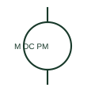

# Permanent-magnet DC motor

A permanent-magnet DC motor uses a permanent magnetic field rather than a separately connected field winding.

[Canonical reference](https://eloragrid.ai/symbols/permanent-magnet-dc-motor) · [Structured record](../entries/permanent-magnet-dc-motor.json) · [All references](README.md)

Updated: 2026-10-27. Drawing use: SLD, Schematic. Reference families: IEC, Manufacturer.

## What it represents

A permanent-magnet DC motor uses a permanent magnetic field rather than a separately connected field winding. Its armature and control connections still require product documentation.

## How to read it

- Do not draw a separate excitation supply unless the actual motor has one.
- The preview is an original explanation of this function. Match the actual drawing convention to its legend and the selected equipment documentation.

## Drawing checklist

- Identify armature polarity
- State motor rating
- Reference speed/control circuit

## Important distinction

Permanent-magnet construction differs from a separately excited DC field winding.

## Facts

- Drawing role: Rotating or linear load
- Representation scope: Functional concept; not an official standard graphic or a product footprint
- Public vendor block reference: HMO1M13, VMO1M13 (Autodesk identifiers; not IEC symbol numbers)
- Identifier status: The short label is a functional lookup label, not an assigned IEC or IEEE symbol number. Any separately listed Autodesk code is a verified vendor block name.

## Public references

- [AutoCAD Electrical: DC motors](https://help.autodesk.com/cloudhelp/2021/ENU/AutoCAD-Electrical/files/GUID-F5F3061F-E0DE-4A9A-BE88-C017545A9A36.htm) — Autodesk. Public documentation of this equipment function or named vendor variant; the illustration is independently authored and is not the source graphic.

## Related references

- [Three-phase motor](motor.md)
- [Contactor](contactor.md)

Original educational concept geometry, CC BY 4.0. Unitless; not a certified standards glyph or manufacturer footprint.

Elora-authored explanations are CC BY 4.0. Linked standards and manufacturer material retain their own rights. Confirm project requirements using primary sources.
