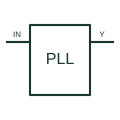

# Phase-locked loop

Controls an oscillator through a phase-comparison feedback arrangement to follow the documented reference.

[Canonical reference](https://eloragrid.ai/symbols/phase-locked-loop) · [Structured record](../entries/phase-locked-loop.json) · [All references](README.md)

Updated: 2026-10-27. Drawing use: Schematic. Reference families: Manufacturer.

## What it represents

Controls an oscillator through a phase-comparison feedback arrangement to follow the documented reference.
On a schematic, identify the reference input, phase detector, loop filter and VCO control and trace the oscillator output, lock indication and feedback divider. Keep the component tag and signal/reference names consistent across the control drawing, terminal schedule and device documentation.
A PLL is a closed control loop; a VCO alone has no phase-comparison feedback function.
The preview is an independently drawn educational functional reference. Add the selected component’s actual power pins, terminal numbers, timing or analogue reference details when producing a construction drawing.

## How to read it

- Identify the reference input, phase detector, loop filter and VCO control.
- Trace the oscillator output, lock indication and feedback divider.

## Drawing checklist

- Label the reference input, phase detector, loop filter and VCO control.
- Cross-reference the oscillator output, lock indication and feedback divider.
- Add the selected device or circuit documentation revision, power/reference connections and project signal convention.

## Important distinction

A PLL is a closed control loop; a VCO alone has no phase-comparison feedback function.

## Facts

- Common schematic mnemonic: PLL — descriptive only; project/device documentation defines reference designations.
- Terminal / interface focus: The reference input, phase detector, loop filter and VCO control
- Artwork scope: Original educational functional/circuit reference; not a selected product pinout.

## Public references

- [CD4046B — phase-locked loops and voltage-controlled oscillators](https://www.ti.com/product/CD4046B) — Texas Instruments. Public primary manufacturer documentation establishes the component function or circuit/topology relationship. Preview geometry and drafting explanations are independently authored.

## Related references

- [Voltage-controlled oscillator](voltage-controlled-oscillator.md)
- [PLC input / output](plc-io.md)

Original educational concept geometry, CC BY 4.0. Unitless; not a certified standards glyph or manufacturer footprint.

Elora-authored explanations are CC BY 4.0. Linked standards and manufacturer material retain their own rights. Confirm project requirements using primary sources.
