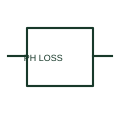

# Phase-loss monitoring relay

A phase-loss relay supervises the presence of the specified phases in a three-phase system.

[Canonical reference](https://eloragrid.ai/symbols/phase-loss-monitoring-relay) · [Structured record](../entries/phase-loss-monitoring-relay.json) · [All references](README.md)

Updated: 2026-10-27. Drawing use: SLD, Schematic. Reference families: Manufacturer.

## What it represents

A phase-loss relay supervises the presence of the specified phases in a three-phase system. The drawing identifies the monitored source and output used by control or protection logic.

## How to read it

- Check whether phase sequence or voltage unbalance is also configured in the selected device.
- The preview is an original explanation of this function. Match the actual drawing convention to its legend and the selected equipment documentation.

## Drawing checklist

- Show phase measurement inputs
- State enabled functions
- Reference output logic

## Important distinction

Phase loss is different from phase reversal or current unbalance.

## Facts

- Drawing role: Monitoring element
- Representation scope: Functional concept; not an official standard graphic or a product footprint
- Public vendor block reference: HCR1F42, VCR1F42 (Autodesk identifiers; not IEC symbol numbers)
- Identifier status: The short label is a functional lookup label, not an assigned IEC or IEEE symbol number. Any separately listed Autodesk code is a verified vendor block name.

## Public references

- [AutoCAD Electrical: Miscellaneous monitoring relays](https://help.autodesk.com/cloudhelp/2021/ENU/AutoCAD-Electrical/files/GUID-31F4CF79-F8E0-4E5A-8C51-4D71640ACDB8.htm) — Autodesk. Public documentation of this equipment function or named vendor variant; the illustration is independently authored and is not the source graphic.

## Related references

- [Current transformer](current-transformer.md)
- [Relay coil](relay-coil.md)

Original educational concept geometry, CC BY 4.0. Unitless; not a certified standards glyph or manufacturer footprint.

Elora-authored explanations are CC BY 4.0. Linked standards and manufacturer material retain their own rights. Confirm project requirements using primary sources.
