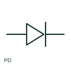

# Photodiode

A photodiode is a light-sensitive semiconductor device used in a documented sensing circuit.

[Canonical reference](https://eloragrid.ai/symbols/photodiode) · [Structured record](../entries/photodiode.json) · [All references](README.md)

Updated: 2026-10-27. Drawing use: Schematic. Reference families: IEC, Manufacturer.

## What it represents

A photodiode is a light-sensitive semiconductor device used in a documented sensing circuit. Its electrical connections and optical input are separate aspects of the representation.

## How to read it

- Identify whether the associated circuit biases the diode or measures its generated response.
- The preview is an original explanation of this function. Match the actual drawing convention to its legend and the selected equipment documentation.

## Drawing checklist

- Show polarity and bias circuit
- Reference optical input
- State selected device type

## Important distinction

A photodiode senses light; an LED emits light.

## Facts

- Drawing role: Semiconductor function
- Representation scope: Functional concept; not an official standard graphic or a product footprint
- Public vendor block reference: HDI1B4, VDI1B4 (Autodesk identifiers; not IEC symbol numbers)
- Identifier status: The short label is a functional lookup label, not an assigned IEC or IEEE symbol number. Any separately listed Autodesk code is a verified vendor block name.

## Public references

- [AutoCAD Electrical: Semiconductor components](https://help.autodesk.com/cloudhelp/2021/ENU/AutoCAD-Electrical/files/GUID-AC954072-7314-4682-88AF-38160D61E9A2.htm) — Autodesk. Public documentation of this equipment function or named vendor variant; the illustration is independently authored and is not the source graphic.

## Related references

- [Resistor](resistor.md)
- [Power converter / inverter](power-converter.md)

Original educational concept geometry, CC BY 4.0. Unitless; not a certified standards glyph or manufacturer footprint.

Elora-authored explanations are CC BY 4.0. Linked standards and manufacturer material retain their own rights. Confirm project requirements using primary sources.
