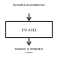

# Photovoltaic arc-fault detection

Solar arc-fault detection analyses monitored circuit behaviour for signs of specified electrical arcing.

[Canonical reference](https://eloragrid.ai/symbols/photovoltaic-arc-fault-detector) · [Structured record](../entries/photovoltaic-arc-fault-detector.json) · [All references](README.md)

Updated: 2026-10-27. Drawing use: Schematic. Reference families: Manufacturer.

## What it represents

Solar arc-fault detection analyses monitored circuit behaviour for signs of specified electrical arcing.
A detector can provide a result to the associated shutdown or protection logic.
Show the monitored solar circuit, sensing path and detection output as separate roles. Arcing can produce features that a detector analyses, but the detector’s indication is not the same thing as opening the circuit. Identify the equipment that responds to the detection decision. This is original functional artwork, not a certified standard graphic or device pinout.

## How to read it

- Identify the circuit and sensing arrangement being monitored.
- Show the detector’s alarm or control output.
- Reference the selected interruption arrangement and detector limitations.
- Detection, decision logic and power interruption must be distinguished in the design.

## Drawing checklist

- Identify the circuit and sensing arrangement being monitored.
- Show the detector’s alarm or control output.
- Reference the selected interruption arrangement and detector limitations.

## Important distinction

Detection, decision logic and power interruption must be distinguished in the design.

## Facts

- Representation type: Original functional block; not a certified IEC or IEEE graphic
- Concept input: Monitored circuit behaviour
- Concept output: Indication or interruption request

## Public references

- [Solar arc protection architecture](https://www.ti.com/solution/solar-arc-protection) — Texas Instruments. Solar arc protection architecture: public technical context for the named function. Product and compliance details remain with the publisher.

## Related references

- [Photovoltaic inverter](photovoltaic-inverter.md)
- [Power converter / inverter](power-converter.md)
- [Terminal connection](terminal.md)

Original educational concept geometry, CC BY 4.0. Unitless; not a certified standards glyph or manufacturer footprint.

Elora-authored explanations are CC BY 4.0. Linked standards and manufacturer material retain their own rights. Confirm project requirements using primary sources.
