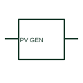

# Photovoltaic generator

A photovoltaic generator represents the electrical production of PV cells or modules.

[Canonical reference](https://eloragrid.ai/symbols/photovoltaic-generator) · [Structured record](../entries/photovoltaic-generator.json) · [All references](README.md)

Updated: 2026-10-27. Drawing use: SLD, Schematic. Reference families: IEC, Manufacturer.

## What it represents

A photovoltaic generator represents the electrical production of PV cells or modules. On an SLD it is linked to documented series/parallel strings, DC protection and the inverter interface.

## How to read it

- Differentiate the generating array from its inverter and any energy-storage branch.
- The preview is an original explanation of this function. Match the actual drawing convention to its legend and the selected equipment documentation.

## Drawing checklist

- Reference module/string arrangement
- State DC ratings
- Show connected inverter/protection

## Important distinction

The PV generator is a DC generating function; the inverter produces the documented AC interface.

## Facts

- Drawing role: Supply or network role
- Representation scope: Functional concept; not an official standard graphic or a product footprint
- Public vendor block reference: HPW1\_S00908, VPW1\_S00908 (Autodesk identifiers; not IEC symbol numbers)
- Identifier status: The short label is a functional lookup label, not an assigned IEC or IEEE symbol number. Any separately listed Autodesk code is a verified vendor block name.

## Public references

- [AutoCAD Electrical: Photovoltaic generator representation](https://help.autodesk.com/cloudhelp/2021/ENU/AutoCAD-Electrical/files/GUID-B290927E-1008-47FA-9D29-3C3149A5382A.htm) — Autodesk. Public documentation of this equipment function or named vendor variant; the illustration is independently authored and is not the source graphic.
- [PV system equipment and string connection layouts](https://www.electrical-installation.org/enwiki/Photovoltaic_system%3A_electrical_equipments_selection) — Schneider Electric. Public documentation of this equipment function or named vendor variant; the illustration is independently authored and is not the source graphic.

## Related references

- [Generator](generator.md)
- [Busbar](busbar.md)

Original educational concept geometry, CC BY 4.0. Unitless; not a certified standards glyph or manufacturer footprint.

Elora-authored explanations are CC BY 4.0. Linked standards and manufacturer material retain their own rights. Confirm project requirements using primary sources.
