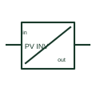

# Photovoltaic inverter

A photovoltaic inverter converts a documented PV DC input into an AC output and provides the selected PV control functions.

[Canonical reference](https://eloragrid.ai/symbols/photovoltaic-inverter) · [Structured record](../entries/photovoltaic-inverter.json) · [All references](README.md)

Updated: 2026-10-27. Drawing use: SLD, Schematic. Reference families: Manufacturer.

## What it represents

A photovoltaic inverter converts a documented PV DC input into an AC output and provides the selected PV control functions. Its schematic keeps DC strings, AC connection and control/protection interfaces distinct.

## How to read it

- Check the number of documented MPPT inputs rather than assuming all DC terminals share one tracker.
- The preview is an original explanation of this function. Match the actual drawing convention to its legend and the selected equipment documentation.

## Drawing checklist

- Identify DC inputs/MPPT groups
- State AC output connection
- Reference network/disconnection controls

## Important distinction

A PV inverter is different from a battery converter even when both connect to the same AC bus.

## Facts

- Drawing role: Energy conversion
- Representation scope: Functional concept; not an official standard graphic or a product footprint
- Identifier status: The short label is a functional lookup label, not an assigned IEC or IEEE symbol number. Any separately listed Autodesk code is a verified vendor block name.

## Public references

- [Photovoltaic technology and inverter functions](https://www.electrical-installation.org/enwiki/Photovoltaic_background%2C_technology) — Schneider Electric. Public documentation of this equipment function or named vendor variant; the illustration is independently authored and is not the source graphic.
- [PV system equipment and string connection layouts](https://www.electrical-installation.org/enwiki/Photovoltaic_system%3A_electrical_equipments_selection) — Schneider Electric. Public documentation of this equipment function or named vendor variant; the illustration is independently authored and is not the source graphic.

## Related references

- [Photovoltaic generator](photovoltaic-generator.md)
- [Power converter / inverter](power-converter.md)
- [Battery](battery.md)

Original educational concept geometry, CC BY 4.0. Unitless; not a certified standards glyph or manufacturer footprint.

Elora-authored explanations are CC BY 4.0. Linked standards and manufacturer material retain their own rights. Confirm project requirements using primary sources.
