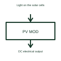

# Photovoltaic module

A photovoltaic module converts light into DC electrical power.

[Canonical reference](https://eloragrid.ai/symbols/photovoltaic-module) · [Structured record](../entries/photovoltaic-module.json) · [All references](README.md)

Updated: 2026-10-27. Drawing use: Schematic. Reference families: Manufacturer.

## What it represents

A photovoltaic module converts light into DC electrical power.
Modules can be interconnected to form a larger generating arrangement.
Show the module’s DC terminals and identify the selected module in the equipment schedule. A module is an assembly of solar cells; a complete array can connect many modules. The symbol identifies the role, while the chosen product and operating conditions determine the actual electrical values. This is original functional artwork, not a certified standard graphic or device pinout.

## How to read it

- Reference the exact module and terminal polarity.
- Identify associated string and module count elsewhere in the drawing.
- Use the selected module documentation for electrical and mounting data.
- A module's electrical output varies with its operating conditions; the symbol is not a rated output value.

## Drawing checklist

- Reference the exact module and terminal polarity.
- Identify associated string and module count elsewhere in the drawing.
- Use the selected module documentation for electrical and mounting data.

## Important distinction

A module's electrical output varies with its operating conditions; the symbol is not a rated output value.

## Facts

- Representation type: Original functional block; not a certified IEC or IEEE graphic
- Concept input: Light on the solar cells
- Concept output: DC electrical output

## Public references

- [Solar electrical system architecture](https://www.ti.com/applications/industrial/energy-infrastructure/solar-energy/overview.html) — Texas Instruments. Solar electrical system architecture: public technical context for the named function. Product and compliance details remain with the publisher.

## Related references

- [Photovoltaic generator](photovoltaic-generator.md)
- [Photovoltaic string](photovoltaic-string.md)
- [Power converter / inverter](power-converter.md)
- [Terminal connection](terminal.md)

Original educational concept geometry, CC BY 4.0. Unitless; not a certified standards glyph or manufacturer footprint.

Elora-authored explanations are CC BY 4.0. Linked standards and manufacturer material retain their own rights. Confirm project requirements using primary sources.
